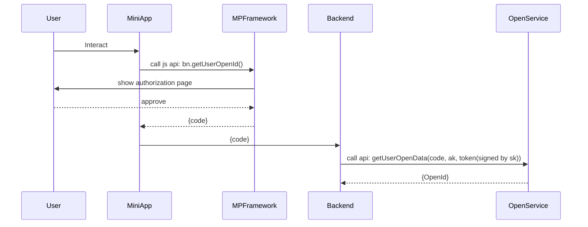

# GetUserOpenId

# <a name="GetOpenId"></a>GetUserOpenId

## <a name="workflow"></a>Workflow



1. The mini app invokes the JavaScript API function `bn.getUserOpenId()` via the mini program
   framework. This step triggers a pop-up authorization page asking for user approval, returning a
   data_token upon user’s consent.
2. The mini app transmits the data_token to the merchant’s backend system.
3. The backend system invokes the ‘getOpenData’ operation with the received data_token, extracting
   the data from the resultant response.
4. The backend decrypts the data to retrieve the user’s openid.

Please note, all necessary APIs can be found in the reference section. This API operates only on
Binance APP version 2.51.0 or later.

## <a name="preparation"></a>Preparation

Please refer to [Preparation Of Open Service](/products/mini-program/openservice/preparation)

## <a name="mini-program"></a>Mini Program

In the mini program, developers can call the JavaScript API function `bn.getUserOpenId()`, which
triggers an authorization pop-up for the user. Upon gaining user consent, the API returns the
data_token which can be used to obtain the user's openid from the backend.

```javascript
bn.getUserOpenId({
  success(res) {
    const code = res.code;
    if (code) {
      api.sendToBackend(code);
    }
  },
});
```

## <a name="Backend"></a>Backend

### <a name="Backend"></a>Backend

**Host**: **dip-cb.binanceapi.com**

**GET** /mp-api/v1/apps/\{appId\}/user-open-data?openData=data_token

**Parameters**

| **Parameter** | **Description**                                 |
| :------------ | :---------------------------------------------- |
| appId         | **required** The AppId of the mini program      |
| openData      | **required** The data_token from previous steps |

Note:

1. The data_token is valid only for 2 minutes.
2. This API must be called with a JWT token in the `X-Mp-Open-Api-Token` header. For generating the
   JWT token, please refer to
   [Description of External Interface Signature Authentication Algorithm](/products/mini-program/openservice/signature)

**Request**

```json
​​{
  "appId": "your-app-id-can-get-from-workspace",
  "openData": "*******",
}
```

**Response**

**HTTP 200**

```json
{
  "code": "000000",
  "message": null,
  "data": {
    "userData": "******"
  },
  "success": true
}
```

| ErrorCode | Remark                    |
| :-------- | :------------------------ |
| 000000    | Success                   |
| 900001    | Invalid Parameter         |
| 900002    | JWT Authentication Failed |
| 900003    | Unexpected Error          |
| 900200    | Data Token Expired        |
| 900201    | Invalid Data Token        |

---

# GetUserOpenId

# <a name="GetOpenId"></a>GetUserOpenId

## <a name="workflow"></a>Workflow


1. The mini app invokes the JavaScript API function `bn.getUserOpenId()` via the mini program
   framework. This step triggers a pop-up authorization page asking for user approval, returning a
   data_token upon user’s consent.
2. The mini app transmits the data_token to the merchant’s backend system.
3. The backend system invokes the ‘getOpenData’ operation with the received data_token, extracting
   the data from the resultant response.
4. The backend decrypts the data to retrieve the user’s openid.

Please note, all necessary APIs can be found in the reference section. This API operates only on
Binance APP version 2.51.0 or later.

## <a name="preparation"></a>Preparation

Please refer to [Preparation Of Open Service](/products/mini-program/openservice/preparation)

## <a name="mini-program"></a>Mini Program

In the mini program, developers can call the JavaScript API function `bn.getUserOpenId()`, which
triggers an authorization pop-up for the user. Upon gaining user consent, the API returns the
data_token which can be used to obtain the user's openid from the backend.

```javascript
bn.getUserOpenId({
  success(res) {
    const code = res.code;
    if (code) {
      api.sendToBackend(code);
    }
  },
});
```

## <a name="Backend"></a>Backend

### <a name="Backend"></a>Backend

**Host**: **dip-cb.binanceapi.com**

**GET** /mp-api/v1/apps/\{appId\}/user-open-data?openData=data_token

**Parameters**

| **Parameter** | **Description**                                 |
| :------------ | :---------------------------------------------- |
| appId         | **required** The AppId of the mini program      |
| openData      | **required** The data_token from previous steps |

Note:

1. The data_token is valid only for 2 minutes.
2. This API must be called with a JWT token in the `X-Mp-Open-Api-Token` header. For generating the
   JWT token, please refer to
   [Description of External Interface Signature Authentication Algorithm](/products/mini-program/openservice/signature)

**Request**

```json
​​{
  "appId": "your-app-id-can-get-from-workspace",
  "openData": "*******",
}
```

**Response**

**HTTP 200**

```json
{
  "code": "000000",
  "message": null,
  "data": {
    "userData": "******"
  },
  "success": true
}
```

| ErrorCode | Remark                    |
| :-------- | :------------------------ |
| 000000    | Success                   |
| 900001    | Invalid Parameter         |
| 900002    | JWT Authentication Failed |
| 900003    | Unexpected Error          |
| 900200    | Data Token Expired        |
| 900201    | Invalid Data Token        |