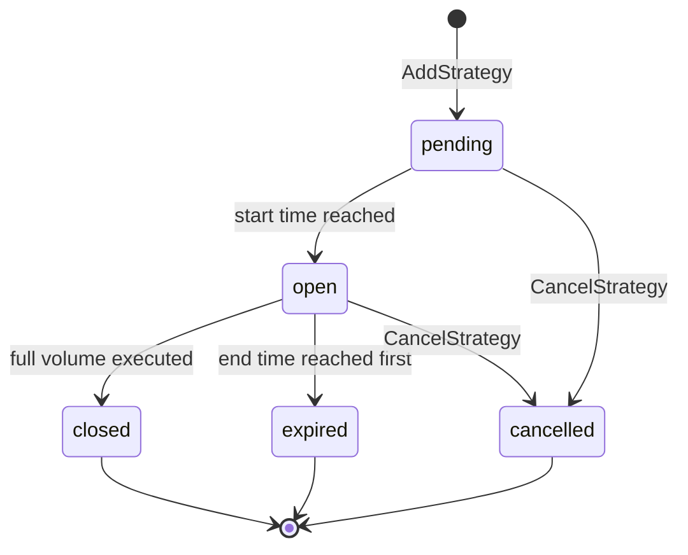

# Algo Trading overview

> What Algo Trading is on Kraken, how strategies differ from orders, and how to create, monitor and cancel them with the Spot REST API

Algo Trading lets you give Kraken a larger trading instruction and have it executed for you over time, instead of placing and managing every order yourself. You describe the outcome you want, for example *buy 10 ETH over the next two hours*, and Kraken works it on the order book on your behalf.

An algo runs as a **strategy**. You create it with a single API call and get back a `strategy_id`. Kraken then places the individual **child orders** until the strategy completes, expires, or you cancel it.

> [!NOTE]
>
> In Kraken Pro, TWAP strategies appear under **Bots**. A strategy you create through the API is the same object you see there.

## Strategies and orders

| | Order | Strategy |
| :- | :- | :- |
| **What you send** | One instruction that goes straight to the order book | A parent instruction that Kraken executes as a series of child orders |
| **Identifier** | `txid`, e.g. `OQCLML-BW3P3-BUCMWZ` | `strategy_id`, e.g. `ASMBA64-R23M2-J7JRJV` (always starts with `AS`) |
| **Lifetime** | Until filled, cancelled or expired | The window you set with `starttm` and `expiretm` |
| **Create** | [`AddOrder`](https://docs.kraken.com/api-reference/trading/add-order) | [`AddStrategy`](https://docs.kraken.com/api-reference/algo-trading/add-strategy) |
| **Monitor** | `OpenOrders`, `ClosedOrders`, `QueryOrders` | `GetOpenStrategies`, `GetClosedStrategies`, `QueryStrategies` |
| **Cancel** | [`CancelOrder`](https://docs.kraken.com/api-reference/trading/cancel-order) | [`CancelStrategy`](https://docs.kraken.com/api-reference/algo-trading/cancel-strategy) |

Strategies run on Kraken's side, next to the matching engine. Your client doesn't need to stay connected, schedule orders or react to fills while a strategy runs. You can disconnect and check on it later.

Child orders are regular exchange orders. They are matched by the same engine and charged the same trading fees as orders you place yourself, and they appear in `ClosedOrders` and trade history.

> [!NOTE]
>
> A child order or fill can't yet be linked back to its `strategy_id` from `ClosedOrders` or trade history. To follow a strategy's progress, use the strategy endpoints: they report the filled volume, average price, total cost and fees for the whole strategy.

## Available strategies

| Strategy | `strategy_type` | What it does | Guide |
| :- | :- | :- | :- |
| **TWAP** (time-weighted average price) | `twap` | Executes a total volume across a time window, aiming for an average price close to the market's average over that window | [TWAP](https://docs.kraken.com/exchange/guides/algo-trading/twap.md) |

More strategy types will be added over time. Each new type gets its own guide here and uses the same endpoints, selected by `strategy_type`.

## Strategy lifecycle

Every strategy type goes through the same statuses.

| Status | Meaning | Returned by |
| :- | :- | :- |
| `pending` | Accepted, waiting for its start time | `GetOpenStrategies`, `QueryStrategies` |
| `open` | Running: Kraken is placing child orders | `GetOpenStrategies`, `QueryStrategies` |
| `closed` | The full `volume` was executed before the end time | `GetClosedStrategies`, `QueryStrategies` |
| `expired` | The end time was reached before the full `volume` was executed. Anything already filled stays filled | `GetClosedStrategies`, `QueryStrategies` |
| `cancelled` | Cancelled with `CancelStrategy`. Anything already filled stays filled | `GetClosedStrategies`, `QueryStrategies` |

A strategy can also carry a `reason` that explains its current state:

| `reason` | When you see it |
| :- | :- |
| `userRequested` | The strategy was cancelled with `CancelStrategy` |
| `insufficientFunds` | The account doesn't have enough balance for the next child order. The strategy keeps running and continues when funds are available |
| `remainingBelowMinimum` | The volume left to execute is below the pair's minimum order size |
| `internalError` | Kraken stopped the strategy because of an internal error. Contact support and quote the `strategy_id` |

## Endpoints

All Algo Trading endpoints are private Spot REST endpoints. They use the same [authentication](https://docs.kraken.com/exchange/guides/rest/authentication.md) as every other `/0/private` endpoint: `API-Key` and `API-Sign` headers, and a `nonce` in the body.

| Endpoint | Use it to | API key permission |
| :- | :- | :- |
| [`AddStrategy`](https://docs.kraken.com/api-reference/algo-trading/add-strategy) | Create a strategy, or validate one with `validate: true` | Orders and trades: *Create & modify orders* |
| [`CancelStrategy`](https://docs.kraken.com/api-reference/algo-trading/cancel-strategy) | Cancel a `pending` or `open` strategy | Orders and trades: *Cancel & close orders* |
| [`GetOpenStrategies`](https://docs.kraken.com/api-reference/algo-trading/get-open-strategies) | List your `pending` and `open` strategies | Orders and trades: *Query open orders & trades* |
| [`QueryStrategies`](https://docs.kraken.com/api-reference/algo-trading/query-strategies) | Look up as many as 20 strategies by `strategy_ids`, in any status | Orders and trades: **both** *Query open orders & trades* and *Query closed orders & trades* |
| [`GetClosedStrategies`](https://docs.kraken.com/api-reference/algo-trading/get-closed-strategies) | Page through `closed`, `expired` and `cancelled` strategies | Orders and trades: *Query closed orders & trades* |

## Quick start

**1. Check your API key**

Enable *Create & modify orders*, *Cancel & close orders*, *Query open orders & trades* and *Query closed orders & trades* on the key. See [API key permissions](https://docs.kraken.com/exchange/guides/rest/api-keys.md).

**2. Validate the request**

Send `AddStrategy` with `validate: true`. Kraken validates the request (pair, volume, price, time window, minimums) without creating or submitting anything. A successful response returns an empty `strategy_id`. This doesn't run the creation-time balance check.

**3. Create the strategy**

Send the same request without `validate`. Store the returned `strategy_id`.

**4. Monitor it**

Poll `QueryStrategies` with your `strategy_id`, or `GetOpenStrategies` for all running strategies. Track `status`, `filled_volume` and `avg_price`.

**5. Cancel or review**

Call `CancelStrategy` to stop it early. After it ends, it is listed by `GetClosedStrategies`.

See the [TWAP guide](https://docs.kraken.com/exchange/guides/algo-trading/twap.md#examples) for complete request and response examples.

## Good to know

* **Spot REST only.** Algo Trading is available on the Spot REST API. WebSocket and FIX support isn't available yet.
* **Execution is managed by Kraken.** How child orders are sized, timed and placed is managed by Kraken and may change as execution improves. The parameters you send, and the guarantees each strategy guide lists (such as the limit price of a limit TWAP), don't change.
* **Funds aren't reserved upfront.** Each child order is checked against your available balance when it's placed, like any other order.
* **Sub-accounts.** A strategy belongs to the account that created it. Requests made for a selected sub-account only see that sub-account's strategies.
* **No amendments yet.** To change a running strategy, cancel it and create a new one.

> [card] [TWAP](https://docs.kraken.com/exchange/guides/algo-trading/twap.md)
>
> How the TWAP strategy works, with parameters and examples

> [card] [Add Strategy](https://docs.kraken.com/api-reference/algo-trading/add-strategy.md)
>
> Full API reference for creating strategies

> [card] [Order lifecycle](https://docs.kraken.com/exchange/guides/general/order-lifecycle.md)
>
> How the child orders behave once they reach the book
