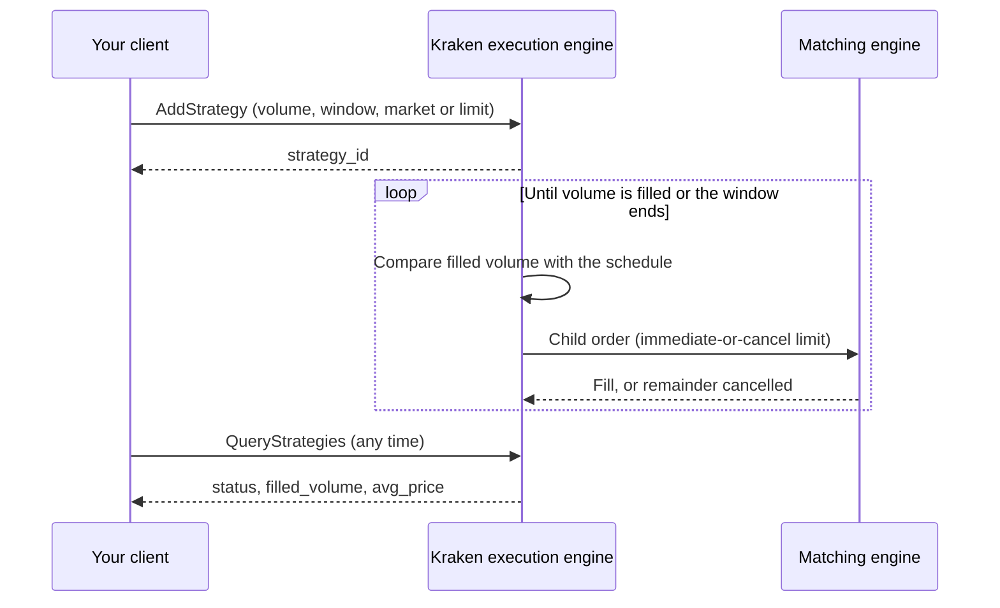

# TWAP strategy

> How Kraken's TWAP (time-weighted average price) strategy works — parameters, child order execution, funds and fees, limits, and API examples

**TWAP** (time-weighted average price) works a large buy or sell across a time window you choose. A single large order can move the price against you. TWAP instead spreads the execution across the window in many smaller child orders. The aim is an average fill price close to the market's average price over that window, with less market impact.

Typical uses:

* Building or reducing a position gradually, without signalling the full size to the market
* Executing size on pairs where the order book is thin
* Running a scheduled buy or sell without keeping a client connected

## At a glance

| | |
| :- | :- |
| **`strategy_type`** | `twap` |
| **Markets** | Spot pairs. No margin or leverage. xStocks pairs aren't supported |
| **Order types** | `market` or `limit` |
| **Time window** | At least 60 seconds. Start and end must each be within 30 days from now |
| **Child orders** | Placed by Kraken as immediate-or-cancel limit orders (current behaviour) |
| **Fees** | Standard trading fees on each fill. No additional fee for using TWAP |
| **Funds** | Not reserved upfront. Best-effort check when the strategy is created, and a check for every child order |
| **API** | Spot REST: [Algo Trading endpoints](https://docs.kraken.com/api-reference/algo-trading/add-strategy.md) |
| **Kraken Pro** | Listed under **Bots** |

## Parameters

Send these fields to [`AddStrategy`](https://docs.kraken.com/api-reference/algo-trading/add-strategy).

| Field | Required | Description |
| :- | :- | :- |
| `symbol` | Yes | Spot pair, e.g. `BTC/USD` or `XBTUSD` |
| `asset_class` | Yes | `forex` for standard Spot pairs |
| `strategy_type` | Yes | `twap` |
| `side` | Yes | `buy` or `sell` |
| `volume` | Yes | Total quantity to execute over the window, in the base currency |
| `ordertype` | Yes | `market` or `limit`. See [Market and limit TWAP](#market-and-limit-twap) |
| `price` | For `limit` only | Your limit: the highest price you'll buy at, or the lowest price you'll sell at. Must be omitted for `market` |
| `starttm` | No | When the strategy starts. `0` or omitted = now, `+<n>` = in `<n>` seconds, `<n>` = unix timestamp in seconds |
| `expiretm` | Yes | When the strategy ends. `+<n>` = in `<n>` seconds, `<n>` = unix timestamp in seconds |
| `validate` | No | `true` validates the request without creating the strategy. It doesn't run the creation-time balance check |

`volume` and `price` follow the same precision and minimum rules as a regular order on the pair. See [`AssetPairs`](https://docs.kraken.com/api-reference/market-data/get-tradable-asset-pairs) for `lot_decimals`, `pair_decimals`, `ordermin` and `costmin`.

## How Kraken executes a TWAP

> [!NOTE]
>
> This section describes current behaviour. How child orders are sized, timed and placed is managed by Kraken and may change as execution improves. Your parameters, and the limit price of a limit TWAP, are always respected.

A TWAP runs in Kraken's algorithmic execution engine, a service that sits alongside the matching engine. The execution engine holds your strategy, follows market data and your fills, and sends child orders to the matching engine through the same path as any other order. Because the logic runs on Kraken's side, a strategy keeps executing whether or not your client is connected.



**1. A schedule across the window.** Kraken spreads `volume` across the time between `starttm` and `expiretm`. At any moment the strategy has a target: the share of the volume that should be filled by now. Halfway through the window, about half the volume should be filled.

**2. Child orders when the strategy is behind.** Kraken checks the strategy regularly against that target and sends a child order whenever the filled volume falls behind it. Child order sizes and timing vary. A TWAP therefore doesn't leave a fixed, predictable pattern on the book that other participants could trade against.

**3. Each child order takes the available price.** Every child order is an immediate-or-cancel limit order:

* **Market TWAP:** priced to trade at the best available price, within Kraken's [market price protection](https://support.kraken.com/hc/en-us/articles/201648183-Market-Price-Protection).
* **Limit TWAP:** priced to trade at the best available price, but never above your `price` for a buy or below it for a sell.

**4. Unfilled quantity is caught up later.** If a child order doesn't fill completely, the unfilled part is cancelled straight away, so child orders never rest on the book. The shortfall stays on the schedule and is picked up by later child orders.

**5. The window closes out.** Kraken completes the remaining volume towards the end of the window, so the last child orders can be larger than earlier ones. If a remainder is smaller than the pair's minimum order size, it is folded into an earlier child order, so the strategy isn't left with an amount it can't trade.

**6. The strategy ends.**

* `closed`: the full `volume` was executed.
* `expired`: the window ended first, for example because a limit TWAP's price was never reached or the account ran out of funds. The filled part stays filled and nothing more is executed.
* `cancelled`: you called `CancelStrategy`.

## Market and limit TWAP

| | Market TWAP | Limit TWAP |
| :- | :- | :- |
| **Child order price** | Best available price, within market price protection | Best available price, capped by your `price` |
| **Price guarantee** | None beyond market price protection | Never fills worse than your `price` |
| **Completion** | Normally completes within the window on liquid pairs | Can end `expired` if the market trades beyond your `price` for long periods |
| **When the market moves away** | Keeps executing at the new prices | Pauses while the market is beyond your `price`, and catches up when it comes back |
| **Use it when** | Finishing the volume matters more than the exact price | You have a hard price limit |

## Funds and fees

* **Fees:** each fill is charged the standard trading fee for your account's fee tier. Child orders are currently immediate-or-cancel, so they take liquidity and are charged the taker fee. TWAP adds no fee of its own. A strategy's `total_fee` reports the fees paid so far.
* **Balance check at creation:** the execution engine performs a best-effort balance check for the full volume. Sells require base currency. Market buys are valued at the current ask; limit buys use the lower of the ask and the limit price, or the limit if no ask is available. Insufficient balance can reject creation with `EOrder:Insufficient funds`. Funds are **not** reserved, and `validate: true` does not run this check.
* **Balance check per child order:** every child order is checked against your available balance when it's placed, exactly like an order you place yourself. Other orders, withdrawals or other strategies can use the same funds in the meantime.
* **Running short:** if a child order can't be funded, the strategy stays `open` with `reason: insufficientFunds` and continues once funds are available. Volume that is still unfilled when the window ends isn't executed, and the strategy ends `expired`.

Each child order also goes through the same checks as a regular order, such as order minimums and account limits.

## Tracking progress

`GetOpenStrategies`, `QueryStrategies` and `GetClosedStrategies` return a `details` object with the strategy's running totals:

| Field | Description |
| :- | :- |
| `volume` | Total volume requested |
| `filled_volume` | Volume executed so far |
| `avg_price` | Average fill price (`total_cost` / `filled_volume`). Empty until the first fill |
| `total_cost` | Total cost of the filled volume, in the quote currency |
| `total_fee` | Total fees paid so far, in the quote currency |
| `starttm` / `expiretm` | The resolved start and end of the window, as unix timestamps in seconds |
| `price` | Your limit price. Only present for a limit TWAP |

Child orders appear in `ClosedOrders` and trade history as limit orders, including for a market TWAP, because that is how they're sent to the book. They do not rest on the book, so use the strategy endpoints to monitor progress. They can't yet be linked back to their `strategy_id` from those endpoints, so use the strategy totals above for your execution reporting.

## Cancelling

`CancelStrategy` stops further child-order scheduling. An already-submitted child order may still fill while cancellation completes, and those fills are kept. The strategy normally finishes as `cancelled` with `reason: userRequested`; if the in-flight order completes the requested volume, it can finish as `closed`. Poll `QueryStrategies` for the terminal status and final execution totals.

To change a running TWAP's volume, price or window, cancel it and create a new one. Amending a strategy isn't supported yet.

## Examples

### Create a limit TWAP

Buy 0.5 BTC over the next hour, never paying more than 60,000 USD.

```json Request: POST /0/private/AddStrategy theme={null}
{
  "nonce": 1781169958000,
  "symbol": "BTC/USD",
  "asset_class": "forex",
  "strategy_type": "twap",
  "side": "buy",
  "volume": "0.5",
  "ordertype": "limit",
  "price": "60000",
  "expiretm": "+3600"
}
```

```json Response theme={null}
{
  "error": [],
  "result": {
    "strategy_id": "ASMBA64-R23M2-J7JRJV"
  }
}
```

### End-to-end in Python

The example validates the request, creates the strategy, checks its progress and cancels it. The request signing is the standard [REST authentication](https://docs.kraken.com/exchange/guides/rest/authentication.md): for a JSON body, the signature covers the `nonce` followed by the exact JSON string you send.

```python twap_example.py theme={null}
import base64, hashlib, hmac, json, time, urllib.request

API_URL = "https://api.kraken.com"
API_KEY = "YOUR_API_KEY"
API_SECRET = "YOUR_API_SECRET"


def private(method: str, body: dict) -> dict:
    path = f"/0/private/{method}"
    body = {"nonce": int(time.time() * 1000), **body}
    data = json.dumps(body)
    sha = hashlib.sha256((str(body["nonce"]) + data).encode()).digest()
    sig = hmac.new(base64.b64decode(API_SECRET), path.encode() + sha, hashlib.sha512)
    req = urllib.request.Request(API_URL + path, data=data.encode(), headers={
        "API-Key": API_KEY,
        "API-Sign": base64.b64encode(sig.digest()).decode(),
        "Content-Type": "application/json",
    })
    resp = json.loads(urllib.request.urlopen(req).read())
    if resp["error"]:
        raise RuntimeError(resp["error"])
    return resp["result"]


twap = {
    "symbol": "BTC/USD",
    "asset_class": "forex",
    "strategy_type": "twap",
    "side": "buy",
    "volume": "0.5",
    "ordertype": "limit",
    "price": "60000",
    "expiretm": "+3600",  # one hour from now
}

# 1. Validate only: nothing is created, strategy_id is empty
private("AddStrategy", {**twap, "validate": True})

# 2. Create
strategy_id = private("AddStrategy", twap)["strategy_id"]
print("created", strategy_id)

# 3. Check progress
try:
    time.sleep(30)
    s = private("QueryStrategies", {"strategy_ids": strategy_id})["strategies"][strategy_id]
    print(s["status"], s["details"]["filled_volume"], "@", s["details"]["avg_price"] or "-")
finally:
    # 4. Attempt cancellation even if monitoring fails (fills so far are kept)
    private("CancelStrategy", {"strategy_id": strategy_id})
```

### Read a strategy's progress

```json Response: POST /0/private/QueryStrategies theme={null}
{
  "error": [],
  "result": {
    "strategies": {
      "ASMBA64-R23M2-J7JRJV": {
        "strategy_id": "ASMBA64-R23M2-J7JRJV",
        "status": "open",
        "details": {
          "strategy_type": "twap",
          "side": "buy",
          "volume": "0.50000000",
          "filled_volume": "0.12500000",
          "avg_price": "59874.2",
          "total_cost": "7484.28",
          "total_fee": "29.94",
          "starttm": "1781169958",
          "expiretm": "1781173558",
          "symbol": "BTC/USD",
          "asset_class": "forex",
          "ordertype": "limit",
          "price": "60000"
        }
      }
    }
  }
}
```

## Validation

`AddStrategy` rejects the request, and creates nothing, when:

| Condition | Example |
| :- | :- |
| The window is shorter than 60 seconds | `expiretm: "+30"` returns `EStrategy:Time horizon too short` |
| `expiretm` isn't in the future, or `starttm`/`expiretm` is more than 30 days away | `expiretm` set to a past timestamp |
| `price` is missing on a limit TWAP, or present on a market TWAP | `ordertype: "market"` with `price` |
| `volume` or `price` is invalid, has too many decimals, or is below the pair minimums | `volume: "0"` |
| The pair is unknown, or is an xStocks pair | `symbol: "FOO/BAR"` |
| `asset_class` is missing or invalid | `asset_class: "crypto"` |

Send `validate: true` to check a request without creating it. Validation doesn't run the creation-time balance check, so a request that passes can still fail with `EOrder:Insufficient funds` when you submit it without `validate`. See the [error reference](https://docs.kraken.com/exchange/guides/general/errors.md) for how errors are returned.

## FAQ

> [accordion] Will my average price equal the market's TWAP exactly?
>
> No. TWAP aims for an average price close to the market's time-weighted average price over the window, but it's not guaranteed. The result depends on liquidity, volatility and, for a limit TWAP, your limit price.

> [accordion] Is my full volume guaranteed to execute?
>
> No. A market TWAP normally completes within the window on liquid pairs. A limit TWAP only trades at or better than your price, so it can end `expired` with part of the volume unfilled. Insufficient funds can also leave volume unfilled.

> [accordion] Do I need to stay connected?
>
> No. The strategy runs on Kraken's side. Disconnecting, or losing your session, doesn't affect it.

> [accordion] Can I run several TWAPs at once?
>
> Yes. Each one is checked against your available balance independently, and funds aren't reserved, so make sure your balance covers all of them. The number of open strategies per account is limited.

> [accordion] Can I change a TWAP after creating it?
>
> Not yet. Cancel it with `CancelStrategy` and create a new one. Fills from the cancelled strategy are kept.

> [accordion] How do I find the trades a TWAP made?
>
> They appear in `ClosedOrders` and trade history like any other orders, but they can't yet be linked to their `strategy_id` there. The strategy's `details` (`filled_volume`, `avg_price`, `total_cost`, `total_fee`) give you the totals.

> [card] [Algo Trading overview](https://docs.kraken.com/exchange/guides/algo-trading/overview.md)
>
> Strategies, lifecycle and endpoints

> [card] [Add Strategy](https://docs.kraken.com/api-reference/algo-trading/add-strategy.md)
>
> API reference for creating a TWAP

> [card] [Get Closed Strategies](https://docs.kraken.com/api-reference/algo-trading/get-closed-strategies.md)
>
> Review finished strategies
