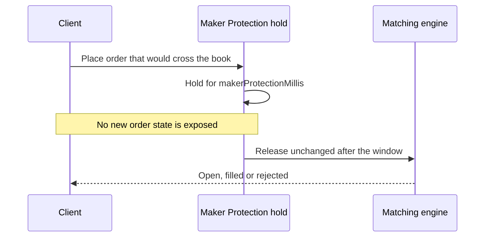
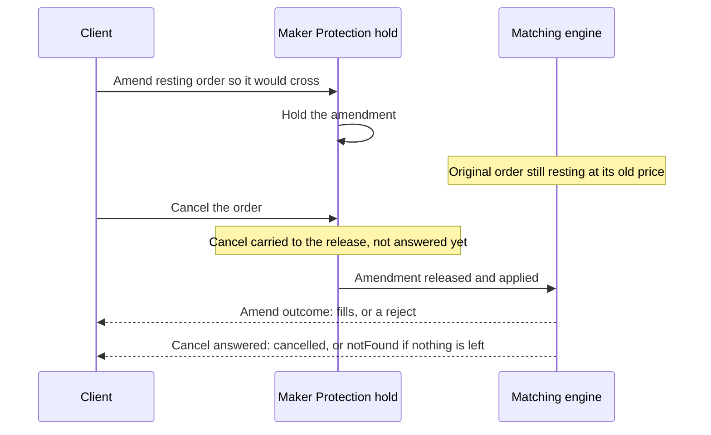

# Maker Protection

> How Maker Protection delays liquidity-taking orders on selected Derivatives markets, and what it changes for REST, WebSocket, and FIX clients

Maker Protection is a short, fixed delay applied to liquidity-taking order actions on selected Derivatives markets. It gives resting maker orders time to react to new information before an incoming aggressor can trade against them.

## Overview

On a market with Maker Protection, any placement or edit that would take liquidity from the book as it arrives is held for the market's configured window before it is matched. A placement or edit that would rest, every post-only order and all cancellations are never held.

| | |
| :- | :- |
| **Window** | 20 ms at launch, published per market as `makerProtectionMillis`. Never more than 100 ms |
| **Applies to** | Selected Derivatives (Futures) markets. Spot is unaffected |
| **Live from** | 24 September 2026 (Phase 1), 8 October 2026 (Phase 2), 29 October 2026 08:00 UTC (Phase 3) |
| **Exempt** | Orders and edits that would rest, post-only orders, all cancellations, accepting an RFQ offer, in-account auction bids, block trades and other off-book flow |
| **Protocols** | Identical behaviour on REST, WebSocket, and FIX |
| **Clients** | Applied per market to every client equally — there are no per-account exemptions |
| **Concurrency** | At most 500 of your requests may be held at once. See [How many orders you can have held at once](#how-many-orders-you-can-have-held-at-once) |

Every client path is held the same way, so the behaviour is the same whichever protocol you use. A held order is not in the book until it is released, so it takes its queue position at release, not at receipt.

> [!NOTE]
>
> Whether an order is held is decided when it arrives, against the book as it stands at that moment: a limit order priced to rest is placed at once, and one priced to cross is held. Market orders always take liquidity and are always held. If you need a guarantee that an order is never held, submit it as post-only.

## Which markets have it

Read `makerProtectionMillis` from the instruments endpoints. It is the authoritative, live source — the market list changes as the rollout progresses.

```bash theme={null}
curl "https://futures.kraken.com/derivatives/api/v3/instruments"
```

```json theme={null}
{
  "symbol": "PF_ATOMUSD",
  "type": "flexible_futures",
  "tradeable": true,
  "makerProtectionMillis": 20
}
```

The field is present on both `GET /instruments` and `GET /trading/instruments`, and is **omitted entirely** when the market has no Maker Protection configured. Treat "absent" and "zero" as the same thing: no delay.

The ten most liquid linear perpetual markets are excluded at every phase, so that active taker flow in the majors is not slowed. Every perpetual listed after 24 September 2026 has Maker Protection applied from launch. Additions to the list are announced on [status.kraken.com](https://status.kraken.com) ahead of each maintenance window.

> [accordion] Phase 1 markets — 24 September 2026
>
> These 59 markets are covered at launch. This list is a point-in-time record; query `makerProtectionMillis` for the current set.
>
> `PF_2ZUSD` · `PF_ALCHUSD` · `PF_ANTHROPICXUSD` · `PF_ASTERUSD` · `PF_ASTRUSD` · `PF_ATOMUSD` · `PF_BELUSD` · `PF_BRENTOILUSD` · `PF_CHFUSD` · `PF_CKBUSD` · `PF_CTSIUSD` · `PF_CYBERUSD` · `PF_DEEPUSD` · `PF_DEGENUSD` · `PF_DYMUSD` · `PF_ENJUSD` · `PF_GALAUSD` · `PF_GRIFFAINUSD` · `PF_HMSTRUSD` · `PF_ICPUSD` · `PF_IDUSD` · `PF_INTCUSD` · `PF_IOSTUSD` · `PF_LCAPUSD` · `PF_LDOUSD` · `PF_LRCUSD` · `PF_METISUSD` · `PF_MINAUSD` · `PF_MTLUSD` · `PF_MUUSD` · `PF_NATGASUSD` · `PF_NBISUSD` · `PF_NEIROUSD` · `PF_OPENAIXUSD` · `PF_OPUSD` · `PF_PENGUUSD` · `PF_PROMPTUSD` · `PF_SAMSUNGUSD` · `PF_SKHYUSD` · `PF_SNDKUSD` · `PF_SOONUSD` · `PF_SOXLUSD` · `PF_SOXSUSD` · `PF_TUSD` · `PF_US100USD` · `PF_VELOUSD` · `PF_VIRTUALUSD` · `PF_WIFUSD` · `PF_WTIOILUSD` · `PF_XAGUSD` · `PF_XAUUSD` · `PF_XCNUSD` · `PF_XCUUSD` · `PF_YFIUSD` · `PF_ZILUSD` · `PI_ETHUSD` · `PI_LTCUSD` · `PI_XBTUSD` · `PI_XRPUSD`

> [accordion] Phase 2 markets — 8 October 2026
>
> These 61 markets were added on 8 October 2026. This list is a point-in-time record; query `makerProtectionMillis` for the current set.
>
> `PF_1INCHUSD` · `PF_ACEUSD` · `PF_AGLDUSD` · `PF_ALICEUSD` · `PF_ARCUSD` · `PF_BATUSD` · `PF_BBUSD` · `PF_BICOUSD` · `PF_BIOUSD` · `PF_BRETTUSD` · `PF_C98USD` · `PF_CAKEUSD` · `PF_CATIUSD` · `PF_CFGUSD` · `PF_CFXUSD` · `PF_CHILLGUYUSD` · `PF_COOKIEUSD` · `PF_CROUSD` · `PF_CSPRUSD` · `PF_CVXUSD` · `PF_GBPUSD` · `PF_GOATUSD` · `PF_GPSUSD` · `PF_IMXUSD` · `PF_IOTXUSD` · `PF_KAIAUSD` · `PF_KAITOUSD` · `PF_KAVAUSD` · `PF_LQTYUSD` · `PF_LUNA2USD` · `PF_MELANIAUSD` · `PF_MEWUSD` · `PF_MNTUSD` · `PF_MOGUSD` · `PF_MORPHOUSD` · `PF_MOVRUSD` · `PF_NOTUSD` · `PF_ONTUSD` · `PF_OPENUSD` · `PF_OPNUSD` · `PF_PEOPLEUSD` · `PF_PIXELUSD` · `PF_PNUTUSD` · `PF_PORTALUSD` · `PF_QNTUSD` · `PF_QTUMUSD` · `PF_RAYUSD` · `PF_ROSEUSD` · `PF_RSRUSD` · `PF_SAGAUSD` · `PF_SPKUSD` · `PF_SSVUSD` · `PF_SUPERUSD` · `PF_SYNUSD` · `PF_SYRUPUSD` · `PF_TLMUSD` · `PF_TRBUSD` · `PF_USUALUSD` · `PF_WUSD` · `PF_ZBTUSD` · `PF_ZIGUSD`

> [accordion] Phase 3 markets — 29 October 2026
>
> These 51 markets were added on 29 October 2026 at 08:00 UTC. This list is a point-in-time record; query `makerProtectionMillis` for the current set.
>
> `PF_AAPLXUSD` · `PF_AMZNXUSD` · `PF_APEUSD` · `PF_BOMEUSD` · `PF_CHZUSD` · `PF_COINXUSD` · `PF_COMPUSD` · `PF_CRCLXUSD` · `PF_DEXEUSD` · `PF_DYDXUSD` · `PF_EGLDUSD` · `PF_EIGENUSD` · `PF_ENSUSD` · `PF_ETHFIUSD` · `PF_FLOWUSD` · `PF_GLDXUSD` · `PF_GOOGLXUSD` · `PF_GRASSUSD` · `PF_GRTUSD` · `PF_HOODXUSD` · `PF_JASMYUSD` · `PF_JUPUSD` · `PF_KASUSD` · `PF_LPTUSD` · `PF_MANAUSD` · `PF_METAXUSD` · `PF_MONUSD` · `PF_MOODENGUSD` · `PF_MSTRXUSD` · `PF_MUBARAKUSD` · `PF_NIGHTUSD` · `PF_NVDAXUSD` · `PF_ORDIUSD` · `PF_PENDLEUSD` · `PF_POPCATUSD` · `PF_QQQXUSD` · `PF_RIVERUSD` · `PF_RUNEUSD` · `PF_SNXUSD` · `PF_SPCXXUSD` · `PF_SPXUSD` · `PF_SPYXUSD` · `PF_STRKUSD` · `PF_STXUSD` · `PF_SUSHIUSD` · `PF_TSLAXUSD` · `PF_TURBOUSD` · `PF_WLFIUSD` · `PF_XPLUSD` · `PF_ZKUSD` · `PF_ZROUSD`

## What is and isn't delayed

| Action | Held? | Notes |
| :- | :- | :- |
| Limit, IOC or FOK order that would cross the book on arrival | Yes | Decided against the book as it stands when the order arrives |
| Limit order that would rest | **No** | Placed at once — it is a maker |
| Market order | Yes | Always takes liquidity |
| Post-only order | **No** | Never held, on any market |
| Edit that reprices a resting order across the book | Yes | Only the reprice waits: a size reduction in the same edit applies at once and keeps the order's queue place |
| Any other edit | **No** | Applied at once |
| Edit of a resting post-only order | **No** | An edit cannot change an order's type |
| A second edit while an edit of the same order is held | **Refused** | `editAlreadyHeld`. The order stays as it rests; send the edit again once the first has released |
| Edit of an order that is not resting, including one whose placement is still held | **No** | Rejected at once with `orderForEditNotFound` |
| Accepting an RFQ offer, or bidding in an in-account auction | **No** | Neither is an order placement |
| Stop / take-profit / trailing-stop placement | **No** | Placing the trigger is not a liquidity-taking action |
| The order a trigger fires | Yes | Held inside the engine, unless the fired order is post-only |
| Order group placing a new non-post-only parent | Yes | Classified by the new parent order |
| Order group attaching to an existing order | **No** | Places only triggers |
| Cancel, cancel-all, cancel-all-after | **No** | Never held. A cancel that reaches a held order is answered when that order releases |

> [!NOTE]
>
> An edit sent immediately after a crossing placement reaches the order while its placement is still held, and is rejected with `orderForEditNotFound`. Wait for the placement's response before editing the order.

## Order lifecycle



Four properties are worth designing around:

* **Your order is validated when the hold opens, not at release.** Margin, price collars and the contract's maximum position are checked on arrival, and the order's margin is reserved for it while it is held. At release only the market is re-read — a suspended or settled market refuses the order — a FOK is measured against the book again, and your open-order limit and client order IDs decide only whether the order may rest. See [What can happen while an order is held](#what-can-happen-while-an-order-is-held) and [When account limits are decided](#when-account-limits-are-decided).
* **The full window is always served.** The hold is decided from market conditions at submission. If the liquidity that made your order aggressive disappears during the window, the order still waits out the delay before entering the book. Held orders are not re-evaluated.
* **The queue is FIFO.** With a fixed delay, holds are released in the order they were accepted. A later order cannot overtake an earlier one inside the queue.
* **The contract is "at least N ms".** Orders you submit are released by a timer and land very close to the configured window. Orders fired by a **trigger** are different: they wait in the matching engine and are released by the next event it processes, so on a quiet market a stop or take-profit can be held noticeably longer than the configured window. Never assume the delay is exact, and never infer it by measuring latency — read `makerProtectionMillis`, which can be changed at any time.

## What can happen while an order is held

A held order is not yet in the book, and it is not guaranteed to get there. The window is an interval in which your order can be rejected by events that have nothing to do with your own trading:

| Event during the window | Outcome for the held order |
| :- | :- |
| You cancel it, or your own cancel-all covers it | The cancel is carried to the release and answered there. The order still reaches matching as submitted, and the cancel then takes whatever would have rested. See [Cancelling a held order](#cancelling-a-held-order) |
| Your `cancelallordersafter` dead man's switch fires | **Carried, not purged.** The order still reaches matching and takes what it can; the switch then cancels whatever would have rested. A dead man's switch cannot recall committed aggression |
| The market is suspended | Rejected with `marketSuspended` |
| Your account is de-risked or liquidated | Refused with `CANCELLED_WHILE_HELD`, so it cannot reach book straight after your account was flattened |
| Margin or price collars move against you | No effect. Both are checked once, when the hold opens, and the order's margin is reserved then. See [When account limits are decided](#when-account-limits-are-decided) |
| You change your leverage or margin mode | Allowed. The change is checked against your held orders as well as your resting orders and positions, and is refused if they would not fit |
| You reach your open-order limit, or the contract's maximum position | The maximum position is decided when the hold opened. The open-order limit is read at release and can only stop the order resting. See [When account limits are decided](#when-account-limits-are-decided) |
| One of your own resting orders is in the way at release | That maker is cancelled, whatever self-trade strategy your account has set. See [Self-trade prevention](#self-trade-prevention) |

The practical consequence: an order that returns a rejection roughly one window after you sent it has usually not been rejected on its own merits. Read the returned status rather than assuming the placement itself was malformed.

## When account limits are decided

A held order is committed but not yet matched, so any account-wide setting you can change during the window would otherwise decide the fate of every order you have in flight — not just the one it names. None of them can refuse a held order at release: they are either settled when the hold opens, or read at release and allowed only to stop the order resting.

| Limit | When it is decided | What happens |
| :- | :- | :- |
| Your open-order limit (`maxOrdersAndTriggers`) | Release | A held placement is **never refused** for your open-order limit. At release, if you have no free slot, it is **converted** so it cannot rest: it trades what it can and the remainder is discarded. If you free a slot during the window, it rests as normal |
| The contract's maximum position | Hold opens | The budget is **reserved for the order at submission**. A placement refused then stays refused even if you free budget; and the budget reserved for it is unavailable to any order you send afterwards, which is refused `MAX_POSITION_EXCEEDED` instead |
| Your client order IDs | Submission and release | The hold reserves its client order ID for the window. A held placement under an ID already in use rests at release only if the ID is free by then. See [Reusing a client order ID inside the window](#reusing-a-client-order-id-inside-the-window) |
| Your margin, and the market's price collars | Hold opens | Checked once, and the order's initial margin is **reserved** for it while it is held. Neither is checked again at release, so neither can reject the order then |

> [!NOTE]
>
> The maximum-position reservation covers only the shapes whose size is known at submission: a plain placement, and an order group's parent when it is one. An initial-margin market order sizes itself from available margin at release, and an amend's realised quantity depends on fills during the window, so neither reserves anything.

Only the market itself is re-read at release: a market suspended or settled during the window refuses the order. A held FOK is also measured against the book again at release and refused whole if it no longer fits. A held market order is priced when its hold opens; if the book has moved in its favour by release, it trades at the better price.

## How many orders you can have held at once

You may have at most **500 requests held at once**. A request past that cap is refused rather than forwarded, with its own error. It is distinct from your open-order limit:

| Interface | Reported as |
| :- | :- |
| REST v3 | `makerProtectionOrderLimitExceeded` |
| REST v4 | `MAKER_PROTECTION_ORDER_LIMIT_EXCEEDED` |
| Market data / SBE | `MAKER_PROTECTION_ORDER_LIMIT_EXCEEDED` |
| FIX | `EGeneral:Other:MAKER_PROTECTION_ORDER_LIMIT_EXCEEDED` |

Before 12 November 2026 this refusal was reported as `tooManyOrders` / `TOO_MANY_ORDERS` / `ORDER_LIMIT_EXCEEDED`. Those values now mean only that you have hit your open-order limit.

Three properties to design around:

* **It bounds simultaneity, not rate.** A hold releases after at most 100 ms and hands its slot straight to the next request, so a steady stream of aggressors well inside the cap is never refused. What the cap prevents is a standing ladder of many live holds at once.
* **The budget is per member, not per account.** A subaccount charges its master's budget, so the cap cannot be side-stepped by spraying the same ladder from many subaccounts — and one strategy sitting at the cap can refuse another's aggressor on the same member.
* **Every held shape counts**, including an order group whose parent is held, and a held amend.

A refusal here means the request never reached the matching engine. It is safe to retry once your earlier holds have released.

## Self-trade prevention

A liquidity-taking order released from a hold **always cancels the resting order of your own it would match**, overriding the self-trade strategy configured on your account (`GET` / `PUT /self-trade-strategy`). It applies across the whole account tree — the maker may belong to your account, your master, a sibling or a sub-account.

This closes an evasion the hold would otherwise leave open: post-only orders are never held, so an account could drop one in front of its own held taker and have the default `REJECT_TAKER` strategy kill the release, recalling committed aggression for the price of one extra message.

| Situation | Resolution |
| :- | :- |
| Released taker meets your own resting order | `CANCEL_MAKER` is forced. The maker is cancelled with reason `CANCELLED_BY_SELF_TRADE` and your taker trades |
| The released order is FOK | `CANCEL_MAKER` is forced here too. A FOK's fillability is measured — when the hold opens and again at release — only against makers it could actually trade, so your own orders in the way are not counted as depth. A FOK that only your own resting liquidity could complete is refused on arrival rather than held |
| The order was never held | Your configured strategy applies as normal |

> [!NOTE]
>
> The same depth rule applies to a FOK that is not held: if your self-trade strategy is `CANCEL_MAKER` and the FOK could only complete by trading your own resting orders, it is refused for insufficient liquidity rather than part-filled.

> [!WARNING]
>
> On the edit path this changes **which of your two orders dies**. A self-matching edit already destroyed the order being amended rather than refusing the edit; with the hold, the maker is cancelled and the amended order trades. If you rely on `REJECT_TAKER` to protect resting quotes on a Maker Protection market, that protection does not hold against your own released aggressors.

## Behaviour by protocol

There is no `held` order state anywhere in the public API. Maker Protection surfaces as extra latency on aggressive placements, not as a new state to model.

> [tab] REST
>
> The connection is simply held for the duration of the delay, and the response carries the final outcome — `placed`, `filled`, `cancelled` or a rejection — exactly as it would without Maker Protection.
>
> Set your client-side request timeout comfortably above the market's `makerProtectionMillis`. A timeout tighter than the window will abandon requests that are about to succeed. The window can never exceed 100 ms, so a single timeout budget covers every market.
>
> > [!WARNING]
> >
> > If you send `processBefore` on an aggressive order, its deadline must allow for the hold. The deadline is evaluated **after** the delay — and re-checked inside the matching engine against the release time — so a `processBefore` shorter than `makerProtectionMillis` rejects every time with `wouldProcessAfterSpecifiedTime`. The deadline is exclusive: a request landing exactly on `processBefore` still trades.
> >
> > An expired deadline also outranks a cancel: if you cancel a held order whose `processBefore` has passed by release, the deadline rejection wins and the order does not trade.

> [tab] WebSocket
>
> Nothing is published while an order is held. You receive the normal `open_orders` and `fills` events once the order is released and the engine acts on it — the only observable difference is that they arrive about `makerProtectionMillis` later.

> [tab] FIX
>
> The FIX gateway sends an advisory `ExecutionReport (8)` when a request is held. It is advisory only: it does not advance the order's lifecycle, and the real `New` or `Replaced` acknowledgement still follows at release. Do not treat it as a terminal state.
>
> **A held placement** reports Pending New:
>
> | Tag | Value |
> | :- | :- |
> | `39` (`OrdStatus`) | `A` — Pending New |
> | `150` (`ExecType`) | `A` — Pending New |
> | `11` (`ClOrdID`) | Your order's client order ID |
> | `37` (`OrderID`) | **Not present** |
> | `41` (`OrigClOrdID`) | Not present |
> | `58` (`Text`) | `held by aggressor speedbump for 20ms` |
> | `60` (`TransactTime`) | When the hold began |
>
> The engine does not assign an order UID until the request is released, so no `OrderID` exists yet — `ClOrdID` is your only handle on the order during the window.
>
> **A held amend** reports Pending Replace instead:
>
> | Tag | Value |
> | :- | :- |
> | `39` (`OrdStatus`) | `E` — Pending Replace |
> | `150` (`ExecType`) | `E` — Pending Replace |
> | `11` (`ClOrdID`) | The amend's client order ID |
> | `41` (`OrigClOrdID`) | The client order ID of the order being amended |
> | `37` (`OrderID`) | **Present** — the target order already has an engine order ID |
> | `58` (`Text`) | `held by aggressor speedbump for 20ms` |
>
> On both reports, `AvgPx (6)` and `GrossTradeAmt (381)` are sent as `0`. FIX requires them, but they carry no meaning before the order reaches the book. The `Text` value interpolates the market's configured window, so it would read `50ms` on a market configured for 50 ms.
>
> > [!NOTE]
> >
> > Two cases produce **no** advisory at all: an order that was already acknowledged before the notice arrived (the signal would be stale), and a held edit that was submitted over REST or the web platform rather than FIX (there is no FIX amend `ClOrdID` to report against).
>
> **Cancelling a held amend** appears as the Pending Replace advisory, then, at release, the amend's outcome — fills, or a reject — followed by the cancel's own `ExecutionReport`. Nothing is sent for the cancel during the window.
>
> > [!NOTE]
> >
> > Where the engine refuses an edit by cancelling the order instead — a quantity that resolves to nothing, an edit that would match your own resting order, or an edit whose own fill drives available margin negative — the trading channel carries a **rejection** with the fault, not an amend acknowledgement. Read the reject rather than assuming the order was amended.

## Cancelling a held order

You can cancel an order while it is held. The cancel itself is never held, but it is **not answered until the order it reaches is released**: the hold carries the cancel to the release and applies it there.

**A cancel cannot recall committed aggression.** At release the order is matched exactly as you submitted it, and only then does the cancel act — it takes whatever of the order would have rested, as an ordinary cancel of a resting order would. It removes the order's right to *rest*, not its obligation to *trade*.

> [!WARNING]
>
> This is the easiest thing to get wrong. `cancel` on an aggressive held order means "do not leave anything resting", not "forget I sent this". If the market has moved in your favour during the window, a cancelled hold **still fills**. Release time never moves, so a cancel cannot be used to buy a free look at the market.

Address the cancel by order ID or by client order ID. For a **held placement** the client order ID is your only option — the engine has not assigned an order ID yet. A **held amend** is different: the order it targets is already resting, so it has an order ID you can use.

The cancel's answer arrives at release, about one window after you sent it, and is decided by what matching left:

| At release | The cancel is answered |
| :- | :- |
| Part of the order would rest — it part-filled, or found nothing to trade | **Success**, order status `cancelled`. The remainder is placed and cancelled in the same engine event, so it never trades as a resting order |
| The order filled whole | **Refused** with `notFound` (REST v3) / `ORDER_FOR_CANCELLATION_NOT_FOUND` (market data), exactly as a cancel chasing a filled unheld order is |
| The order was IOC, FOK or market | **Refused** with `notFound` once the order has executed — nothing of it can rest for the cancel to take |
| The order was refused at release — for example its `processBefore` passed | **Refused** with `notFound`. The order's own response carries the reason |

The order's own placement response is unchanged by the cancel: fills, and a `placed` remainder when one would rest, exactly as if you had not cancelled. Read the cancel's own response to see what it took.

The same applies to an order a trigger fires, which is held inside the engine: a cancel is carried to its release on the same terms.

| Also | Result |
| :- | :- |
| A second cancel of the same held order | **Refused at once** with `notFound`. The first cancel still answers at release |
| A cancel that lands after release | An ordinary cancel: `cancelled` if the order is resting, `notFound` if it filled or expired at release |

> [!NOTE]
>
> **Edits cannot claim a held order.** Only a cancel can — a single cancel, or your own cancel-all. An order carries at most one held request at a time: an edit of a held placement is rejected with `orderForEditNotFound`, and a second edit of an order whose edit is held is refused with `editAlreadyHeld`.

### How a withdrawn hold is reported

The sweeps that do withdraw a held order — an exchange or admin cancel-all, a liquidation or a de-risk — remove it before it is matched, and it is reported as:

| Interface | Reported as |
| :- | :- |
| REST v3 | Order status `cancelled` |
| Market data / SBE | Order error `WOULD_PROCESS_AFTER_SPECIFIED_TIME` |

There is no dedicated "cancelled while held" value in the public enums. Distinguish this case by the cancel you sent, not by the code. If you had sent a cancel of a held order that such a sweep then withdraws, your cancel is refused with `notFound`; the order's own response reports the withdrawal.

### Cancelling while an edit is held

Amending a resting order so that it would cross the book can be cancelled too, and the outcome is the one instruction that reads least like a cancel.

While the amend is held, **the original order is still live in the book, unchanged, at its old price** — the amendment has not been matched, so the order can still trade on its old terms during the window.

A cancel of that order inside the window is **carried** to the amend's release: the order is not cancelled from the book in the meantime, and the cancel is not answered yet. A repeated cancel is refused at once with `notFound`. At release, the amend is applied as you sent it — it reprices the order and trades what it crosses — and the cancel then takes whatever of the order is left resting. Same order ID, same client order ID, same order group.

Both of your instructions therefore take effect — the amend crosses, and what it would have left behind does not stay on the book:



| At release | Outcome |
| :- | :- |
| The reprice crosses and fills the order whole | The amend reports its fills. The cancel is refused with `notFound` — there is nothing left to take |
| The reprice crosses and part-fills, or does not cross | The amend reports as usual. The cancel takes the remainder and is answered `cancelled` |
| The engine refuses the edit | The edit response carries the refusal reason, and the cancel then takes the order as it rested |
| The target is genuinely gone | The edit is rejected with `orderForEditNotFound`, and the cancel with `notFound` |

> [!NOTE]
>
> `orderForEditNotFound` is **not** the expected outcome of cancelling during a held amend. If you see it, the order had genuinely already left the book — it is not the signature of this race.

If the amend also reduced the order's size, the reduction was applied to the resting order when the hold opened, so the order rests at the new size and its old price for the window. Only one amend of an order can be held at a time; a second is refused with `editAlreadyHeld`.

### Cancelling a held order group

An order group whose new parent order would take liquidity is held as a unit: its parent is held, and the group and its members are placed from the parent's outcome at release. Address a cancel to the parent's **client order ID** — no order ID has been returned to you yet. The cancel is carried to the release like any other: the group is placed, the parent trades what it can, and the cancel then takes whatever of the parent would have rested, as an ordinary cancel of the parent would.

> [!WARNING]
>
> **Known limitation — OCO siblings do not see held legs.** A group member whose activated order is held inside the engine is invisible to sibling cancellation and reduction, which walk booked orders and registered triggers only. If an opposing sibling fills during the hold window, the held leg is not removed, and **both legs of the group can go live**. Reconcile group state from fills after any sibling fill on a Maker Protection market rather than assuming one leg cancelled the other. A fix is in progress.

### Reusing a client order ID inside the window

A hold **reserves its client order ID** for the length of the window, so that a committed aggressor cannot be recalled by racing another order onto the same identifier. Two cases follow, and they are answered differently:

| You send | Outcome |
| :- | :- |
| A placement that would not be held — it would rest, or is post-only — reusing an ID that a **live hold** reserved | Refused immediately at submission with `clientOrderIdAlreadyExist` |
| A placement that is held, under an ID a live hold or one of your **resting** orders already uses | Held as normal. At release it rests only if the ID is free by then; otherwise it is **converted** so it cannot rest, and it still trades. Cancelling the resting order during the window frees the ID |

The reservation lasts as long as the hold and is dropped when the order is released, or as soon as you cancel the held order, since a cancelled hold can no longer rest. Held amends do not reserve an ID — the order they target is already resting at the matching engine, which remains the authority for that identifier.

If you cancel an order and immediately replace it reusing the same client order ID, both can be in flight within one window. While that is true, the replacement is addressable **by order ID only** — a cancel by client order ID still resolves to the first order, and is refused with `notFound` because that order already carries your first cancel.

Either wait out the window before reusing an identifier, or address in-flight cancels by order ID.

> [!TIP]
>
> If you need "get me out entirely, with nothing left resting and nothing new trading", there is no request that does it inside the window. Wait out the window — it is capped at 100 ms — and then cancel. Anything you send during the hold can only change whether the order rests.

## Cancel-all while orders are held

Your own `cancelallorders` reaches every held placement and held amend in scope on exactly the same terms as a single cancel: it is carried to each hold's release, the held order is matched as submitted, and the sweep then cancels whatever of it would have rested.

Because a held amend's target is already resting at the engine, a sweep that reaches one also **carves that order out of the sweep**: it is deliberately left in the book until the amend releases, and the sweep's cancel then removes what is left of it. So a `cancelallorders` on a Maker Protection market can return having left an order resting, by design.

| Request | Effect on held orders | Carve-out |
| :- | :- | :- |
| Your own `cancelallorders` | Carried to release, as above | Yes — the targets of held amends are left resting until release |
| `cancelallordersafter` (dead man's switch) | **Carried**, on the same terms as your own cancel-all. The aggression still reaches matching; only the remainder is lost | Yes, as above |
| An exchange or admin cancel-all, a liquidation or a de-risk | **Purged**, with `CANCELLED_WHILE_HELD`. Nothing lands after the book is wiped | No |

> [!WARNING]
>
> **A dead man's switch does not recall a held aggressor.** It pulls your resting orders and stops the held order resting, but the order still reaches matching and takes whatever liquidity it can. No cancellation of any shape can withdraw committed aggression inside the window — only an exchange-side sweep can, and that is not something you can trigger.

> [!NOTE]
>
> **Known gap.** A held *amend* whose target is swept loses that target, so its aggression cannot be preserved: the amend is answered as a rejection rather than applied. Reconcile from the amend's own response rather than assuming the sweep result covers it.

Two consequences worth designing around:

* **A carved-out bracket parent keeps its group's triggers.** They are not cancelled with the rest of the sweep, so the position the amend fills is not left without its take-profit and stop-loss.
* **An order spared by one sweep stays spared.** Once a sweep has reached a held amend, the order it targets is left alone by later cancel-alls too, until that amend releases and removes it.

Held orders a sweep reaches are reported through their own placement or edit responses and are **not** listed in the cancel-all response.

## Batch orders

A batch is not held as a single unit. Each instruction is decided on its own, exactly as if you had sent it separately:

* Each instruction that **would take liquidity** — a placement or edit that would cross the book — is held on its own for the window. Held instructions are released in batch order.
* **Every other instruction** — post-only and resting placements, non-crossing edits, and cancels — is processed on arrival, **wherever it sits in the batch**. Nothing waits because it was written after an aggressor.
* A cancel placed **after** the order it targets reaches that order's hold within the same batch and is carried to its release, exactly as a separate cancel would. A cancel placed **before** it cannot claim anything: at that point the placement does not exist yet, so the cancel resolves against whatever order you already had under that identifier.

Because the instructions that are not held are processed first, a reduce-only instruction placed after an aggressive opening order in the same batch is checked against your position **before** the held order trades.

Self-trade resolution is decided per member: only a member released from a hold forces the cancellation of your own resting order. Every other member keeps the self-trade strategy your account configured.

## Reference

| Value | Where | Meaning |
| :- | :- | :- |
| `makerProtectionMillis` | `GET /instruments`, `GET /trading/instruments` | The market's hold in milliseconds. Absent when not configured |
| `wouldProcessAfterSpecifiedTime` | REST order status | `processBefore` deadline expired — including a deadline shorter than the hold |
| `WOULD_PROCESS_AFTER_SPECIFIED_TIME` | Market data order error | Also reported for a hold withdrawn before release by an exchange or admin cancel-all |
| `editAlreadyHeld` / `EDIT_ALREADY_HELD` | REST v3 / v4 edit status | An earlier edit of the order is still held. The order is left as it rests. Reported as `EDIT_HAS_NO_EFFECT` on market data |
| `iocWouldNotExecute` | REST order status | A hold converted because of your open-order limit or a client order ID clash could not trade at release. Seen on orders you submitted as plain limit orders |
| `IOC_WOULD_ENTER_BOOK` | Market data order error | The same case on market data |
| `CANCELLED_BY_SELF_TRADE` | Order update reason | Your resting order was cancelled so a released aggressor of yours could trade |
| `notFound` / `ORDER_FOR_CANCELLATION_NOT_FOUND` | REST v3 cancel status / market data | A cancel carried to a release found nothing left resting — the order filled whole, was IOC/FOK/market, or was refused. Also a second cancel of a held order, or a cancel that arrived after the order had terminated |
| `orderForEditNotFound` | REST order status | The edit's target is not resting: it had genuinely left the book by the time a held edit released, or its placement is still held. **Not** the outcome of cancelling during a held amend |
| `marketSuspended` | REST order status | The market was suspended while the order was held |
| `clientOrderIdAlreadyExist` | REST order status | A placement reused a client order ID that a live hold had already reserved. Refused at submission, not at release |
| `makerProtectionOrderLimitExceeded` / `MAKER_PROTECTION_ORDER_LIMIT_EXCEEDED` | REST v3 / v4 order and edit status | You already have 500 requests held. Also reported as `MAKER_PROTECTION_ORDER_LIMIT_EXCEEDED` on market data and `EGeneral:Other:MAKER_PROTECTION_ORDER_LIMIT_EXCEEDED` on FIX |
| `MAX_POSITION_EXCEEDED` | Order error | The contract's maximum position, decided when the hold opened, or consumed by a reservation an earlier held order still holds |
