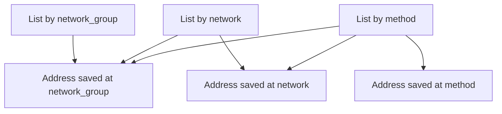
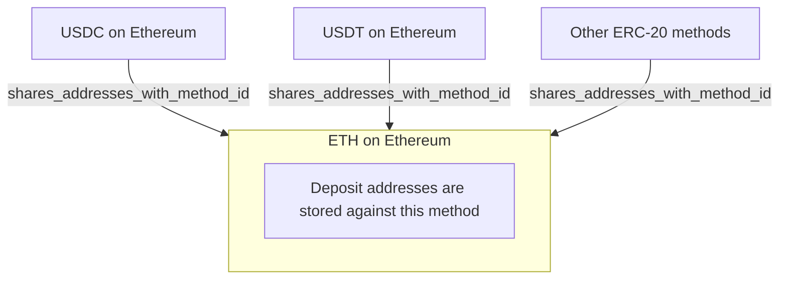

# Spot REST Funding (Beta)

> How to save withdrawal addresses, create withdrawals, and claim deposit addresses with the Funding (Beta) API

> [card] [Spot REST OpenAPI](https://docs.kraken.com/openapi/spot-rest.yaml)
>
> Download the Spot REST OpenAPI spec (YAML), including the Funding (Beta) endpoints

The Funding (Beta) API replaces the legacy `/0/private` funding endpoints with stable IDs, reusable
address scopes, and fee pinning. Relative to v0, the main gains are:

* **Stable IDs** for methods, networks, and addresses. Integrations are not tied to fragile
  display-name strings
* **Reusable withdrawal addresses.** Save once at network or network-group scope and use across
  methods
* **Fee pinning.** Lock a quoted fee rate with a fee token so automated withdrawals are insulated
  from fee changes between quote and submit
* **Simpler Query Funds permissioning** for read-only endpoints. Monitoring keys no longer need
  compound Withdraw or Deposit permissions (a Query Funds-only key can therefore access more via
  these endpoints than it could on the legacy API, including withdrawal addresses and history).
  See [New Funding Endpoints - Permission Changes From Legacy](https://support.kraken.com/articles/funding-api-v1).

This guide covers:

1. Adding a withdrawal address
2. Creating a withdrawal
3. Claiming a deposit address and depositing crypto

Authentication uses the same API key and secret as the rest of the Kraken REST API. For key
setup, see [Spot REST Authentication](https://docs.kraken.com/exchange/guides/rest/authentication.md). Funding requests sign each
call and send `api-key`, `api-sign`, and `api-nonce` headers as shown in the helper below (the
signed path includes the query string). Schemas are in the
[Funding API reference](https://docs.kraken.com/api-reference/funding-beta/list-funding-methods.md).

## Prerequisites

* A Kraken account with an API key that includes the funding permissions you need. See
  [Permission Changes From Legacy](https://support.kraken.com/articles/funding-api-v1)
  for how those permissions differ from the legacy endpoints, and
  [Withdrawal addresses API permission Risks](https://support.kraken.com/articles/withdrawal-addresses-api-permission)
  for the risks of Add withdrawal addresses.
* Your API secret for request signing
* For withdrawals: a funded balance and a verified destination address

### Shared Python helper

The examples below call `funding_request` from this helper. Nested query objects
are encoded as `asset[class]=…` style parameters, matching what these Funding
API endpoints expect.

```python theme={null}
import base64
import hashlib
import hmac
import json
import time
import urllib.error
import urllib.parse
import urllib.request

BASE_URL = "https://api.kraken.com"
API_KEY = "YOUR_API_KEY"
API_SECRET = "YOUR_API_SECRET"  # base64-encoded

_last_nonce = 0


class KrakenApiError(Exception):
    """Non-2xx Kraken API response with a typed error body."""

    def __init__(self, status: int, body: dict):
        self.status = status
        self.body = body
        super().__init__(f"{status}: {body}")


def _nonce() -> str:
    global _last_nonce
    candidate = int(time.time() * 1000)
    _last_nonce = max(candidate, _last_nonce + 1)
    return str(_last_nonce)


def _flat_query(params: dict | None) -> str:
    if not params:
        return ""
    return urllib.parse.urlencode(params, doseq=True)


def _nested_query(params: dict | None) -> str:
    if not params:
        return ""
    pairs: list[tuple[str, str]] = []

    def add(name: str, value) -> None:
        if isinstance(value, dict):
            for child_name, child_value in value.items():
                add(f"{name}[{child_name}]", child_value)
        elif isinstance(value, bool):
            pairs.append((name, "true" if value else "false"))
        elif value is not None:
            pairs.append((name, str(value)))

    for key, value in params.items():
        add(key, value)
    return urllib.parse.urlencode(pairs)


def signed_rest_request(
    method: str,
    path: str,
    params: dict | None = None,
    body: dict | None = None,
    *,
    nested_query: bool = False,
):
    """Send a signed Kraken REST API request."""
    nonce = _nonce()
    query = _nested_query(params) if nested_query else _flat_query(params)
    signed_path = f"{path}?{query}" if query else path
    body_bytes = (
        json.dumps(body, separators=(",", ":")).encode() if body is not None else b""
    )
    digest = hashlib.sha256(nonce.encode() + body_bytes).digest()
    signature = base64.b64encode(
        hmac.new(
            base64.b64decode(API_SECRET),
            signed_path.encode() + digest,
            hashlib.sha512,
        ).digest()
    ).decode()

    headers = {
        "api-key": API_KEY,
        "api-sign": signature,
        "api-nonce": nonce,
    }
    if body is not None:
        headers["content-type"] = "application/json"

    request = urllib.request.Request(
        f"{BASE_URL}{signed_path}",
        data=body_bytes or None,
        headers=headers,
        method=method,
    )
    try:
        with urllib.request.urlopen(request) as response:
            return json.loads(response.read().decode())
    except urllib.error.HTTPError as exc:
        error_body = json.loads(exc.read().decode())
        raise KrakenApiError(exc.code, error_body) from exc


def funding_request(
    method: str,
    path: str,
    params: dict | None = None,
    body: dict | None = None,
):
    """Send a signed Funding API request."""
    return signed_rest_request(method, path, params, body, nested_query=True)
```

## Section 1: Adding a withdrawal address

In the new Funding API, each saved withdrawal address is stored against exactly one
**scope**: a funding method, a network, or a network group. The scope you choose controls which
withdrawals can use that address later.

| Scope | Field | Address can be used with |
| - | - | - |
| Network group | `network_group_id` | Any withdraw method on any network in that group |
| Network | `network_id` | Any withdraw method on that network |
| Method | `method_id` | Only that single method |

### How networks and methods group together

Funding methods sit under networks, and related networks sit under network groups:

```
Network group   (for example, EVM)
  └── Network   (for example, Ethereum)
        └── Method   (for example, USDC on Ethereum)
```

Broader scope means more reuse. Saving once at the EVM network-group level means you do not
need a separate saved address for every EVM method underneath it. Saving at the Ethereum
network level reuses the address across assets on Ethereum. Saving at the method level limits
the address to that one route.

> [!NOTE]
>
> Addresses saved against a `network` or `network_group` scope are fully usable through the API
> today, but they do not yet appear in the Kraken website withdrawal address book. Frontend
> support for these broader scopes is planned soon.
>
> Managing fiat withdrawal addresses through the Funding API is not available at this time. The
> address book endpoints support crypto withdrawal addresses only. Fiat withdrawals can still be
> submitted with
> [Create Funding Withdrawal](https://docs.kraken.com/api-reference/funding-beta/create-funding-withdrawal.md) using fiat
> addresses added via the Kraken UI.

### Which addresses are returned when you list

Listing expands **upward** only. The filter you pass decides how far up the tree the response
looks:



* List by **method** returns addresses saved on that method, its network, and its network group.
* List by **network** returns addresses saved on that network and its network group, not
  method-only addresses under the network.
* List by **network group** returns only group-scoped addresses.

When you withdraw with a given method, you can use **any** address returned by listing with
that method's `method_id`: group-, network-, or method-scoped. That list is the complete set of
destinations valid for the withdrawal.

### Endpoints in this flow

Use these endpoints to discover IDs, create an address, and confirm what is usable:

| Step | Method | Path |
| - | - | - |
| List networks and network groups | `GET` | `/funding/v1/networks` |
| List withdraw methods | `GET` | `/funding/v1/methods/withdraw` |
| Create a saved address | `POST` | `/funding/v1/addresses` |
| List saved addresses | `GET` | `/funding/v1/addresses` |

```
┌──────────────────┐   ┌──────────────────┐   ┌──────────────────┐   ┌──────────────────┐
│ List Funding     │──▶│ List Funding     │──▶│ Create Funding   │──▶│ List Funding     │
│ Networks         │   │ Methods          │   │ Address          │   │ Addresses        │
└──────────────────┘   └──────────────────┘   └──────────────────┘   └──────────────────┘
GET /funding/v1/       GET /funding/v1/       POST /funding/v1/      GET /funding/v1/
networks               methods/withdraw       addresses              addresses
```

### Saving a withdrawal address

The following example saves a reusable Ethereum address for withdrawals.

#### Step 1: List funding networks

discover `network_id` and `network_group_id` values:

```python theme={null}
networks = funding_request("GET", "/funding/v1/networks")
for group in networks["network_groups"]:
    print(group["name"], group["network_group_id"])
```

Response:

```json theme={null}
{
  "network_groups": [
    {
      "network_group_id": "f95acdb7-48fb-4441-b5b4-843d3bf60e61",
      "name": "EVM",
      "network_ids": [
        "d9d375da-44b7-4be1-8a00-8b281acfe366",
        "9637bc15-ec8a-43de-8310-887f0a02a9ed",
      ]
    }
  ],
  "networks": [
    {
      "network_id": "d9d375da-44b7-4be1-8a00-8b281acfe366",
      "name": "Ethereum"
    },
    {
			"network_id": "9637bc15-ec8a-43de-8310-887f0a02a9ed",
			"name": "Base"
		},
  ]
}
```

#### Step 2: List funding methods

Select the withdraw method for your asset and note its network. Filter by asset using a nested
`asset` object. In the query string that becomes
`asset[class]=currency&asset[name]=USDC`:

```python theme={null}
methods = funding_request(
    "GET",
    "/funding/v1/methods/withdraw",
    params={
        "asset": {"class": "currency", "name": "USDC"},
        "limit": 50,
    },
)
for method in methods["methods"]:
    network = method.get("network") or {}
    print(
        method["method_name"],
        method["method_id"],
        network.get("network_name"),
        network.get("network_id"),
    )
```

Response:

```json theme={null}
{
  "methods": [
    {
      "asset": {"class": "currency", "name": "USDC"},
      "method_id": "67b765fd-4efd-42dc-8ce7-63352971d566",
      "method_name": "USDC - Ethereum",
      "minimum_amount": "0.01",
      "network": {
        "network_id": "d9d375da-44b7-4be1-8a00-8b281acfe366",
        "network_name": "Ethereum",
        "contract_address": "0xa0b86991c6218b36c1d19d4a2e9eb0ce3606eb48",
        "on_chain_asset_symbol": "USDC"
      }
    }
  ]
}
```

From here:

* `method_id` = `67b765fd-4efd-42dc-8ce7-63352971d566`
* `network_id` = `d9d375da-44b7-4be1-8a00-8b281acfe366` (Ethereum)
* `network_group_id` = `f95acdb7-48fb-4441-b5b4-843d3bf60e61` (EVM)

#### Step 3: Create funding address

Save the address at **network** scope so any funding method on Ethereum can use it:

```python theme={null}
created = funding_request(
    "POST",
    "/funding/v1/addresses",
    body={
        "scope": {"network_id": "d9d375da-44b7-4be1-8a00-8b281acfe366"},
        "address_details": {
            "crypto": {"address": "0xBef7B36845cA31045E86D0B46DBCac4e6752..."}
        },
        "name": "Personal Wallet",
        "description": "My Ethereum hardware wallet address",
    },
)
print(created["address_id"], created["verified"])
```

Response:

```json theme={null}
{
  "address_id": "AB7J4FF-BGM7G-V2JMIH",
  "verified": true
}
```

Addresses created through this endpoint are verified automatically and do not require email
verification. That makes API-managed destinations immediately usable for withdrawals. Review the
risks of this permission in
[Withdrawal addresses API permission](https://support.kraken.com/articles/withdrawal-addresses-api-permission).

Use `scope.method_id` or `scope.network_group_id` instead when you want narrower or broader
reuse. On blockchains that allow a tag or memo, you can include an optional `tag` or `memo`
under `address_details.crypto`. Either field is accepted.

> [!NOTE]
>
> If you save an address with `tag` but the method or network uses `memo`,
> [List Funding Addresses](https://docs.kraken.com/api-reference/funding-beta/list-funding-addresses.md) returns the value
> as `memo`. The same applies in reverse.

#### Step 4: List funding addresses

List by method to see every address usable for `USDC - Ethereum`:

```python theme={null}
listed = funding_request(
    "GET",
    "/funding/v1/addresses",
    params={
        "scope": {"method_id": "67b765fd-4efd-42dc-8ce7-63352971d566"},
        "limit": 50,
    },
)
for address in listed["addresses"]:
    print(address["address_id"], address["scope"], address.get("name"))
```

Response. Notice the three scopes in one method-scoped list:

```json theme={null}
{
  "addresses": [
    {
      "address_id": "AB7J4FF-BGM7G-V2JMIH",
      "scope": {"network_id": "d9d375da-44b7-4be1-8a00-8b281acfe366"},
      "address_details": {
        "crypto": {"address": "0xbef7b36845ca31045e86d0b46dbcac4e6752..."}
      },
      "name": "Personal Wallet",
      "verified": true
    },
    {
      "address_id": "ABSXEMA-3FXQS-T7Q2FG",
      "scope": {"method_id": "67b765fd-4efd-42dc-8ce7-63352971d566"},
      "address_details": {
        "crypto": {"address": "0x1d0f55b2bcc52b9a92838e6afff2336438e0..."}
      },
      "verified": true
    },
    {
      "address_id": "ABR6SXP-SF6CY-VJMONY",
      "scope": {"network_group_id": "f95acdb7-48fb-4441-b5b4-843d3bf60e61"},
      "address_details": {
        "crypto": {"address": "0x5d7347ff6cd27a96c58e1426d45710c6d153..."}
      },
      "verified": true
    }
  ]
}
```

Listing the same book by network omits method-only addresses:

```python theme={null}
by_network = funding_request(
    "GET",
    "/funding/v1/addresses",
    params={
        "scope": {"network_id": "d9d375da-44b7-4be1-8a00-8b281acfe366"},
        "limit": 50,
    },
)
```

Listing by network group returns only group-scoped addresses:

```python theme={null}
by_group = funding_request(
    "GET",
    "/funding/v1/addresses",
    params={
        "scope": {"network_group_id": "f95acdb7-48fb-4441-b5b4-843d3bf60e61"},
        "limit": 50,
    },
)
```

Any of the addresses returned by the method-scoped list can be passed as `address_id` when
you create a withdrawal for that method.

## Section 2: Creating a withdrawal

### Workflow

1. **List funding methods:** choose the withdraw `method_id`.
2. **Calculate funding fees:** quote the fee and receive a `withdrawal_fee_token`.
3. **Create funding withdrawal:** submit with `address_id` and the fee token.

```
┌──────────────────┐   ┌──────────────────┐   ┌──────────────────┐
│ List Funding     │──▶│ Calculate        │──▶│ Create Funding   │
│ Methods          │   │ Funding Fees     │   │ Withdrawal       │
└──────────────────┘   └──────────────────┘   └──────────────────┘
GET /funding/v1/       GET /funding/v1/       POST /funding/v1/
methods/withdraw       fees/{method_id}       withdrawals
```

### Step 1: List funding methods

Reuse the methods call from Section 1. In this example we withdraw **5 USDC** on Arbitrum One
(`USDC - Arbitrum One`):

* `method_id`: `d4ec4d52-b159-428e-ba64-f45455a978a1`
* `address_id`: `ABR6SXP-SF6CY-VJMONY` (EVM network-group scoped address, valid for Arbitrum)

### Step 2: Calculate funding fees

```python theme={null}
quote = funding_request(
    "GET",
    "/funding/v1/fees/d4ec4d52-b159-428e-ba64-f45455a978a1",
    params={"amount": "5", "fee_included": True},
)
fee_token = quote["withdrawal_fee_token"]
print(quote["fee"], quote["net_amount"], quote["gross_amount"])
```

Response (token truncated):

```json theme={null}
{
  "fee": {
    "asset": {"class": "currency", "name": "USDC"},
    "amount": "1.00000000"
  },
  "gross_amount": {
    "asset": {"class": "currency", "name": "USDC"},
    "amount": "5.00000000"
  },
  "net_amount": {
    "asset": {"class": "currency", "name": "USDC"},
    "amount": "4.00000000"
  },
  "fee_details": {
    "base_fee": {
      "asset": {"class": "currency", "name": "USDC"},
      "amount": "1.00000000"
    },
    "fee_percentage": "0"
  },
  "withdrawal_fee_token": "AAAAAAAAAAHG33Wc1eES6QpeGgMok_gUnlZC7Y5niezI2,MBriLCyg8oqCX7SH1bSqY6SfmC2ZLf_SgTxNZj4Cd1RLPaTyZEDTlz1Pfb8XJ7W0Gev9J1S7TX4M4CUnxoUyq..."
}
```

`fee_included=true` means the amount you pass is the total debit from your balance.

The `withdrawal_fee_token` is an unique quote token returned with the fee calculation. It locks
in the quoted fee **rate** (the base fee and any percentage component) so a later withdrawal can
charge that rate instead of whatever the live fee happens to be at submit time. The token is
valid for **5 minutes** from when it was issued, and you can reuse the same token on **multiple
withdrawals** during that window. After it expires, request a new quote.

When you withdraw with a token, use the same `fee_included` setting you used for the quote. If
you withdraw the same amount you quoted, the fee matches the quote exactly. If the method charges
a percentage and you withdraw a different amount, that percentage is reapplied to the new amount
while still using the locked-in rate.

### Step 3: Create funding withdrawal

Submit the fee token under `fee.quoted_fee.token`:

```python theme={null}
withdrawal = funding_request(
    "POST",
    "/funding/v1/withdrawals",
    body={
        "scope": {"method_id": "d4ec4d52-b159-428e-ba64-f45455a978a1"},
        "address_id": "ABR6SXP-SF6CY-VJMONY",
        "amount": {
            "asset_amount": {
                "asset": {"class": "currency", "name": "USDC"},
                "amount": "5",
            }
        },
        "fee": {
            "quoted_fee": {"token": fee_token},
            "fee_included": True,
        },
    },
)
print(withdrawal["withdrawal_id"])
print(withdrawal["net_amount"], withdrawal["gross_amount"], withdrawal["fee"])
```

Response:

```json theme={null}
{
  "withdrawal_id": "FTVZiTI-e02T84mm87JmibnObWNdnW",
  "net_amount": {
    "asset_amount": {
      "asset": {"class": "currency", "name": "USDC"},
      "amount": "4.00000000"
    }
  },
  "gross_amount": {
    "asset_amount": {
      "asset": {"class": "currency", "name": "USDC"},
      "amount": "5.00000000"
    }
  },
  "fee": {
    "asset_amount": {
      "asset": {"class": "currency", "name": "USDC"},
      "amount": "1.00000000"
    }
  }
}
```

Notes:

* `scope` selects the withdraw method. You can pass `network_id` instead only when that network
  has exactly one available method for the asset; otherwise the request is ambiguous.
* The destination `address_id` may be method-, network-, or network-group-scoped, as long as it
  is compatible with the method you selected.
* Instead of a fee token, you can accept the current fee and optionally set a maximum:

```python theme={null}
"fee": {
    "current_fee": {
        "max_fee": {
            "asset_amount": {
                "asset": {"class": "currency", "name": "USDC"},
                "amount": "1",
            }
        }
    },
    "fee_included": True,
}
```

* Optional `expected_address` lets you confirm the on-chain destination still matches the saved
  address before the withdrawal proceeds.

## Section 3: Depositing funds

Deposit addresses belong to a **funding method**: one way to move one asset on one network,
for example depositing USDC on Ethereum. You always claim and list with a `method_id`. You do
not choose a network or network-group scope the way you do for withdrawal addresses.

### Workflow

1. **List funding methods:** choose a deposit `method_id`.
2. **List claimed deposit addresses:** reuse an existing address if one is returned.
3. **Claim funding deposit address:** only when you need another address.

```
┌──────────────────┐   ┌──────────────────┐   ┌──────────────────┐
│ List Funding     │──▶│ List Claimed     │──▶│ Claim Funding    │
│ Methods          │   │ Deposit Addresses│   │ Deposit Address  │
└──────────────────┘   └──────────────────┘   └──────────────────┘
GET /funding/v1/       GET /funding/v2/       PUT /funding/v1/
methods/deposit        deposit/addresses      deposit/address
```

Claiming can reserve a **new** address, so list first and only claim when you need another
one. Some methods share an on-chain address with another method. You can still list and claim
with the method you want to deposit to. See [Shared deposit addresses](#shared-deposit-addresses)
if you need that model.

### Step 1: List funding methods

```python theme={null}
deposit_methods = funding_request(
    "GET",
    "/funding/v1/methods/deposit",
    params={
        "asset": {"class": "currency", "name": "USDC"},
        "limit": 50,
    },
)
for method in deposit_methods["methods"]:
    deposit = method.get("deposit") or {}
    network = method.get("network") or {}
    print(
        method["method_name"],
        method["method_id"],
        network.get("network_name"),
        deposit.get("address_generation"),
    )
```

Response:

```json theme={null}
{
  "methods": [
    {
      "asset": {"class": "currency", "name": "USDC"},
      "method_id": "27ede8db-804b-4d91-8e25-46b7b9668730",
      "method_name": "Standard",
      "minimum_amount": "2",
      "network": {
        "network_id": "d9d375da-44b7-4be1-8a00-8b281acfe366",
        "network_name": "Ethereum",
        "contract_address": "0xa0b86991c6218b36c1d19d4a2e9eb0ce3606eb48",
        "on_chain_asset_symbol": "USDC"
      },
      "deposit": {
        "address_generation": {
          "status": "limited",
          "limit": 5
        },
        "shares_addresses_with_method_id": "a001231f-488e-48c0-b36c-6e0d2c1ee247"
      }
    }
  ]
}
```

`address_generation` tells you whether you can create more unused addresses for this method
(`unlimited`, `limited` plus `limit`, or `unsupported`). If `shares_addresses_with_method_id`
is present, this method reuses another method's addresses. You can ignore that field for the
walkthrough below and still list or claim with this `method_id`.

### Step 2: List claimed deposit addresses

This is the call to make when a user selects a deposit method and you need the address (and
any tag or memo) to display. Pass the method as `scope.method_id`.

```python theme={null}
claimed_list = funding_request(
    "GET",
    "/funding/v2/deposit/addresses",
    params={
        "scope": {"method_id": "27ede8db-804b-4d91-8e25-46b7b9668730"},
        "limit": 20,
    },
)
for address in claimed_list["addresses"]:
    print(address["method_id"], address["address_details"])
```

Response:

```json theme={null}
{
  "addresses": [
    {
      "address_details": {
        "crypto": {
          "address": "0xBef7B36845cA31045E86D0B46DBCac4e6752..."
        }
      },
      "method_id": "27ede8db-804b-4d91-8e25-46b7b9668730"
    }
  ]
}
```

If `tag` or `memo` is present, include it with the address. Deposits sent without a required
tag or memo may not be credited.

If the list is empty, claim an address in Step 3. Deposit claimed-address listing is separate
from the withdrawal address book in Section 1.

### Step 3: Claim funding deposit address

Claim with the `method_id` you want to deposit to. That does not have to be the method the
address is stored against. If the method shares addresses, Kraken returns the shared address.

```python theme={null}
claimed = funding_request(
    "PUT",
    "/funding/v1/deposit/address",
    body={"method_id": "27ede8db-804b-4d91-8e25-46b7b9668730"},
)
crypto = claimed["address_details"]["crypto"]
print(crypto["address"], crypto.get("tag"), crypto.get("memo"))
```

Response:

```json theme={null}
{
  "address_details": {
    "crypto": {
      "address": "0xBef7B36845cA31045E86D0B46DBCac4e6752..."
    }
  }
}
```

Where `address_generation` is limited (typically `limit: 5`), you may hold up to five unused
claimed addresses for that method at a time. If you are already at the limit, claim returns
`TooManyDepositAddresses`. List existing addresses instead. Once one of those addresses has
received a deposit, you can claim another; the oldest unused address then begins expiring and
is removed after **7 days**.

## Shared deposit addresses

On many networks, token deposit methods use the **same** on-chain address as the network's
native asset. Kraken stores that address against the native method. The token methods reuse it.

| Network | Address stored against | Token methods that reuse it |
| - | - | - |
| Ethereum | ETH on Ethereum | ERC-20 tokens (USDC, USDT, and others) |
| Tron | TRX on Tron | TRC-20 tokens |
| Solana | SOL on Solana | SPL tokens |

Ethereum looks like this:



The same pattern applies on Tron (TRC-20s stored against TRX) and Solana (SPLs stored against
SOL). List Funding Methods tells you this with `deposit.shares_addresses_with_method_id`. The
field is omitted when a method has its own addresses.

You still list and claim with the method the user selected. For USDC on Ethereum, pass the
USDC `method_id`. Kraken returns the shared ETH address. You do not look up or claim against
ETH on Ethereum first. The same is true for a TRC-20 on Tron or an SPL on Solana.

> [!NOTE]
>
> Not all networks that have an EVM deposit address share addresses. Methods on the same network
> can share (ERC-20s with ETH on Ethereum, TRC-20s with TRX on Tron, SPLs with SOL on Solana).
> Methods in the same network group do not always share. Trust
> `shares_addresses_with_method_id` rather than assuming two methods share because they look
> related.

### The same address, two `method_id` values

`method_id` on a claimed address is not always the method the address is stored against. It
depends on the list filter.

Listed for USDC (`scope.method_id` = USDC on Ethereum), as in Step 2. Use this when you are
showing the user where to send USDC:

```json theme={null}
{
  "address_details": {
    "crypto": {
      "address": "0xBef7B36845cA31045E86D0B46DBCac4e6752..."
    }
  },
  "method_id": "27ede8db-804b-4d91-8e25-46b7b9668730"
}
```

Listed with no method filter. `method_id` is ETH on Ethereum, because that is where the
address is stored:

```json theme={null}
{
  "address_details": {
    "crypto": {
      "address": "0xBef7B36845cA31045E86D0B46DBCac4e6752..."
    }
  },
  "method_id": "a001231f-488e-48c0-b36c-6e0d2c1ee247"
}
```

| List filter | `method_id` in the response |
| - | - |
| `scope.method_id` (USDC) | USDC on Ethereum |
| None or `scope.network_id` | ETH on Ethereum (where it is stored) |

The same split happens on other networks. A TRC-20 listed by its own `method_id` reports that
token method; listed with no method filter it reports TRX on Tron. An SPL listed by its own
method reports the SPL; unscoped it reports SOL on Solana.

If you list every claimed address and then keep rows whose `method_id` is USDC, you will miss
this address. Put USDC in `scope.method_id` on the request instead.
