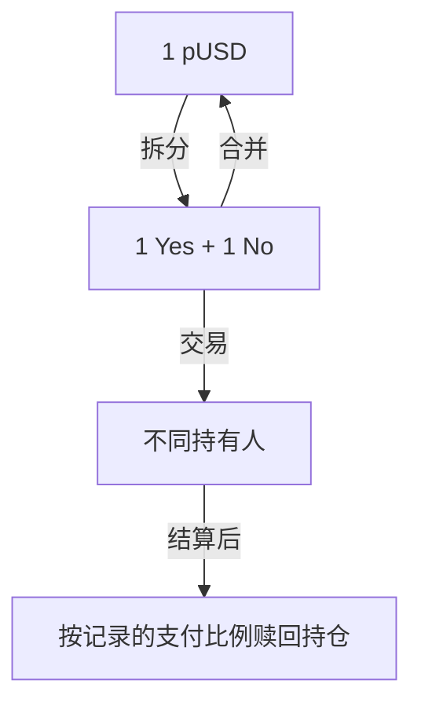

# 持仓与代币

> 了解 Polymarket 的结果代币和持仓运作方式

Polymarket 上的每项预测都由**结果代币或持仓**表示。交易时，你买卖这些结果。你的**持仓**是你在某个市场结果上的余额。



## 结果代币和持仓

每个二元市场都有两个结果持仓：

| 持仓 | 获得全部支付的条件 |
| - | - |
| **Yes** | condition 发生 |
| **No** | condition 未发生 |

结果代币和持仓是 Polygon 上的 ERC-1155 余额。两种系统可以管理这些余额：

| 属性 | Polymarket V2 | CTF |
| - | - | - |
| **账本** | PositionManager | [Gnosis Conditional Tokens](https://github.com/gnosis/conditional-tokens-contracts/) |
| **资产标识** | Polymarket V2 Position ID | CTF 代币 ID |
| **完整持仓** | 由市场模块管理的互补持仓 | 互补的 CTF 结果代币 |
| **背书路径** | 市场模块直接记账 pUSD | 抵押品适配器将 pUSD 连接到 CTF 抵押品记账 |
| **支付模型** | 市场模块记录每个持仓的支付权重 | 支付向量和分母决定每个结果的份额 |

> [!NOTE]
>
> 一组完整的 Yes 和 No 持仓由 `1 pUSD`
> 的价值背书。价值的持有和释放方式取决于管理该持仓的系统。

### 拆分

将 pUSD 转换为完整结果持仓。拆分 `1 pUSD` 会创建 1 个 Yes 持仓和 1 个 No 持仓。

```
100 pUSD → 100 个 Yes 持仓 + 100 个 No 持仓
```

适用于：

* 为做市创建库存
* 同时获得市场的两边持仓

### 交易

在订单簿上买卖结果代币或持仓。大多数用户通过这种方式获得持仓。

* **以 `$0.60` 买入 Yes**：支付 `$0.60`，获得 1 个 Yes 持仓
* **以 `$0.60` 卖出 Yes**：交出 1 个 Yes 持仓，获得 `$0.60`

结算前，你可以随时卖出持仓。

### 合并

将一组完整持仓转换回 pUSD。合并要求 Yes 和 No 持仓数量相等。

```
100 个 Yes 持仓 + 100 个 No 持仓 → 100 pUSD
```

适用于：

* 不通过交易退出持仓
* 将积累的持仓转换回抵押品

### 赎回

市场结算后，按记录的支付比例将持仓兑换为 pUSD。

| 结果 | Yes 持仓 | No 持仓 |
| - | - | - |
| 事件发生 | 每个价值 \$1 | 每个价值 \$0 |
| 事件未发生 | 每个价值 \$0 | 每个价值 \$1 |

```
100 个获胜持仓 → 100 pUSD
```

某些结算可以分配拆分支付，而不是完整的 `$1` 或 `$0`。管理持仓的系统会在赎回时应用其支付模型。

整体生命周期相同，但授权和合约路径不同。准确操作请参阅[持仓工作流](https://docs.polymarket.com/cn/trading/positions/how-positions-work.md)。

### 持仓价值

持仓价值取决于当前市场价格：

```
持仓价值 = 持仓余额 × 当前价格
```

如果你持有 100 个 Yes 持仓，且 Yes 的交易价格为 \$0.75：

```
持仓价值 = 100 × $0.75 = $75
```

## 盈亏

利润取决于市场结算结果和你的入场价格。

### 示例：以 0.40 买入 Yes

| 情况 | 结果 | 回报 | 利润 |
| - | - | - | - |
| 事件发生 | Yes 获胜 | \$1.00 | 每个持仓 +\$0.60，收益率 150% |
| 事件未发生 | No 获胜 | \$0.00 | 每个持仓 -\$0.40，收益率 -100% |

### 持仓奖励

Polymarket 会根据你在符合条件的市场中的持仓总价值，支付年化 **4.00%** 的持仓奖励。系统每小时随机抽样一次持仓总价值，并每日发放奖励。奖励率可以调整。

### 示例：结算前卖出

你可以在市场结算前卖出，以锁定利润或减少损失：

* 以 `$0.40` 买入 Yes
* 价格升至 `$0.70`
* 以 `$0.70` 卖出，每个持仓获利 `$0.30`，收益率 75%


This documentation is built and hosted on [Mintlify](https://mintlify.com), a developer documentation platform.
