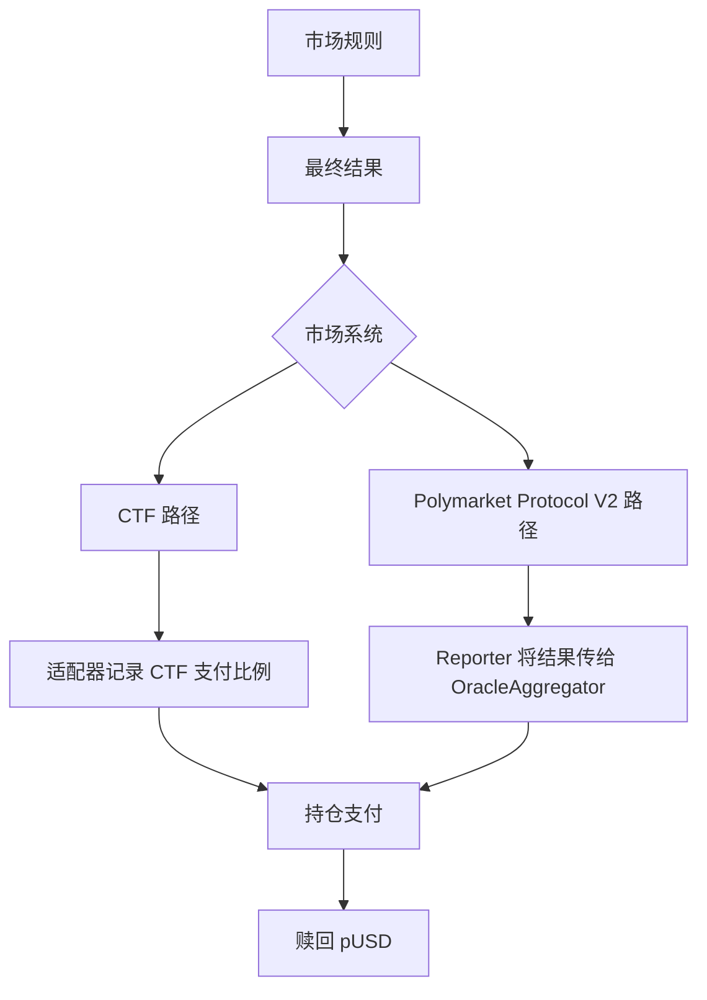

# 结算

> 了解市场如何确定结果，以及如何赎回获胜持仓

当事件结果确定后，市场会进入**结算**。结算会记录每个结果的支付比例，持仓者随后可以将持仓赎回为 pUSD。

市场规则决定最终结果。链上记录结果的路径取决于市场使用 CTF 合约还是 Polymarket Protocol V2。



## 结算规则

每个市场都预先定义了结算规则，其中包括：

* **结算来源**：用于确定结果的信息来源，例如官方公告或指定网站
* **结束日期**：市场何时具备结算条件
* **边界情况**：如何处理含义不明确的情况

> [!WARNING]
>
> 交易前请阅读结算规则。市场标题只是摘要，完整规则决定最终结果。

## CTF 结算

这类市场通过适配器连接 UMA Optimistic Oracle 与 Gnosis Conditional Tokens。标准适配器和负风险适配器会把预言机结果传给对应的 CTF condition。

流程如下：

1. 提议者向 UMA Optimistic Oracle 提交结果并缴纳保证金
2. 结果可以在配置的挑战期内被质疑
3. 未受质疑的结果成为最终结果，受质疑的结果按 UMA 流程继续处理
4. 适配器将最终支付比例报告给 Gnosis Conditional Tokens
5. 持仓者通过 CTF 抵押品适配器赎回并获得 pUSD

> [!WARNING]
>
> 错误或过早的提议可能损失保证金。提交提议或质疑前，请检查市场规则和当前预言机状态。

UMA 合约地址请参阅[结算合约](https://docs.polymarket.com/cn/resources/contracts.md#结算合约)。

### 有争议的结果

如果提议受到质疑，UMA 流程可能要求新一轮提议，或升级到 Data Verification Mechanism。UMA 投票者会根据市场规则和提交的证据确定结果。

挑战期、保证金和升级时间由各市场配置。不要假设所有市场都使用同一个值。

## Polymarket Protocol V2 结算

Polymarket Protocol V2 将结果来源与持仓记账分开。**OracleAggregator** 通过获准的 reporter 模块接收结果，并将最终结果转发给对应的市场模块。

当前公开的 reporter 包括：

* **OOReporter Module**：连接 Optimistic Oracle 结果
* **Chainlink Reporter Module**：连接 Chainlink 报告的结果
* **EOA Reporter Module**：接受获授权 EOA 报告的结果

结果确定后，市场模块会为 PositionManager 持仓记录支付比例。持仓者通过该模块赎回持仓并获得 pUSD。

本页说明公开的结算路径，不说明其运营配置。部署地址和审计信息请参阅[合约](https://docs.polymarket.com/cn/resources/contracts.md)。

## 结算之后

市场完成结算后：

* **停止交易**：不能再买卖该市场的持仓
* **结果持仓获得支付比例**：典型二元结果向获胜方支付 `$1`，向失败方支付 `$0`
* **结果可以拆分支付**：如果规则要求，记录的支付模型可以在多个结果之间分配价值
* **可以赎回**：持仓者销毁可赎回持仓并获得 pUSD

```
100 个支付 $1 的持仓 → 100 pUSD
```

## 规则补充

在少数情况下，交易开始后出现的意外情况需要补充说明规则。对于使用 UMA 的 CTF 市场，Polymarket 可以发布 **Additional context** 更新，提议者和投票者在结算时应考虑该更新。

规则补充：

* 不能改变问题的基本意图
* 通过 bulletin board 合约发布到链上
* 在提交或质疑结果时应予以考虑

> [!TIP]
>
> 如果你认为市场需要补充说明，请通过 Polymarket Discord 提出。

## 资源

* [UMA Oracle Portal](https://oracle.uma.xyz/)：查看并处理 Optimistic Oracle 提议
* [UMA 文档](https://docs.uma.xyz/)：了解 Optimistic Oracle 和 Data Verification Mechanism
* [Polymarket 合约安全记录](https://github.com/Polymarket/contract-security)：查看已部署合约和审计
* [UmaCtfAdapter 源代码](https://github.com/Polymarket/uma-ctf-adapter)：查看 CTF 预言机适配器

## 后续步骤

> [card] [持仓与代币](https://docs.polymarket.com/cn/concepts/positions-tokens.md)
>
> 了解持仓如何拆分、合并和赎回。


This documentation is built and hosted on [Mintlify](https://mintlify.com), a developer documentation platform.
