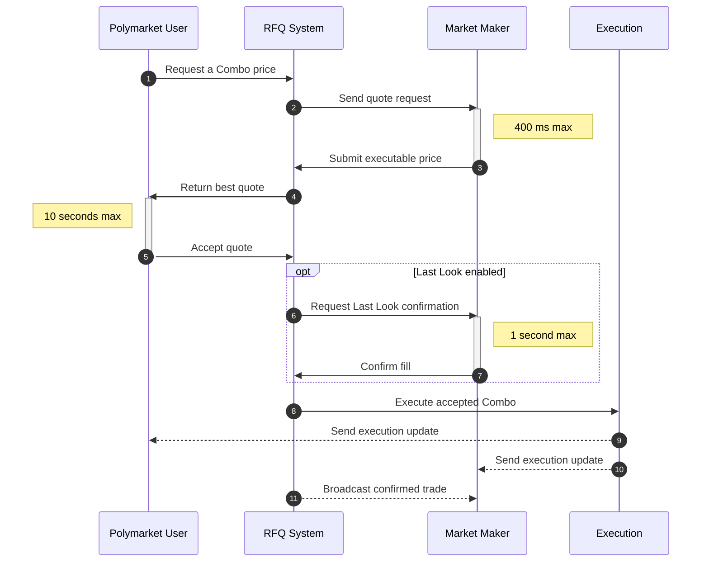

# Combos 的运作方式

> 了解多腿市场的 Combo 持仓和 RFQ 流程

Combos 将两个或更多市场结果组合成一对 YES 和 NO 持仓。每条腿都是来自支持 Combo 的市场的 Polymarket Protocol V2 Position ID。

询价（RFQ）系统会在询价方和已连接的做市商之间撮合。询价方提交一组腿，做市商返回可执行价格，询价方可以接受最佳报价。

1. **用户创建未签名的 Request**，请求 Combo 价格。
2. **RFQ 系统将 Request 发送给**已连接的做市商。
3. **做市商在 400 毫秒的提交窗口内提交已签名的 Quote**。
4. **RFQ 系统将最佳 Quote 返回给用户**。
5. **用户在 10 秒的接受窗口内签署交易，以接受 Quote**。
6. **启用 Last Look 时，RFQ 系统请求 Last Look 确认**。
7. **做市商在 1 秒的确认窗口内确认或拒绝**。
8. **RFQ 系统执行已接受的 Combo**。
9. **用户收到执行更新**。
10. **做市商收到执行更新**。
11. **已连接的做市商收到已确认交易的广播**。

> [!NOTE]
>
> Combo 腿始终使用 Polymarket Protocol V2 Position ID。一个市场也可以提供用于
> CLOB 交易的 CTF 代币 ID。不要用这些 CTF 代币 ID 替换 Combo 市场目录返回的
> Position ID。

## 使用 Combos 构建

将 Combos 集成到做市系统或请求可执行价格的应用中。

> [card] [做市商](https://docs.polymarket.com/cn/trading/combos/market-makers.md)
>
> 构建用于定价和执行 Combos 的做市商集成。

> [card] 询价方
>
> 即将推出
>
> 请求 Combo 报价并执行已接受的交易。

This documentation is built and hosted on [Mintlify](https://mintlify.com), a developer documentation platform.
