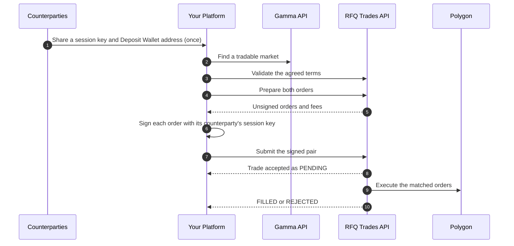

# RFQ Trades Partner API

> Settle trades that two counterparties agreed on your platform as one matched pair of signed Polymarket orders.

The Request for Quote (RFQ) Trades Partner API lets your platform settle
trades that two counterparties negotiated off Polymarket. Each side is a
standard Polymarket exchange order signed for that counterparty, your platform
submits the signed pair in one request, and Polymarket executes it on Polygon.
The orders never rest on the order book. See the
[Institutional Overview](https://docs.polymarket.com/partners/overview.md) for how RFQ trades relate to the
order book.

> [!NOTE]
>
> Access is by invitation. Polymarket issues your API key during partner
> onboarding. To request access, email
> [institutional@polymarket.com](mailto:institutional@polymarket.com).

## How an RFQ Trade Works

Your platform authenticates every request with its partner API key. Each
counterparty authorizes only its own side: it gives your platform a
[session key](#session-keys) for its Polymarket
[Deposit Wallet](https://docs.polymarket.com/trading/wallets-auth.md#wallet-types), and your platform signs
that counterparty's orders with it.



1. [**Find a market**](#find-markets) through the public Gamma API.
2. [**Validate the terms**](#validate-the-terms) (optional). One request runs
   the market, price, account, and guardrail checks and reports all of them.
3. [**Prepare the orders**](#prepare-the-orders) (optional). Polymarket builds
   both unsigned orders, their signing payloads, and the fee each side pays.
4. [**Sign the orders.**](#sign-the-orders) Your platform signs each order
   with its counterparty's session key.
5. [**Submit the trade.**](#submit-the-trade) This is the only request that
   creates a trade.
6. [**Track the trade**](#track-the-trade) until it reaches `FILLED` or
   `REJECTED`, by polling or over the WebSocket stream.

### Operations

Every RFQ trade is one of three operations, determined by the sides of the two
orders. The collateral is [pUSD](https://docs.polymarket.com/concepts/pusd.md), Polymarket's USDC-backed
ERC-20 token on Polygon.

| Operation | Orders | What happens on-chain | Party keys |
| - | - | - | - |
| `split` | Two buys: one YES, one NO, for the same number of shares | Both sides pay pUSD. A complete set is minted and split between them. | `yes`, `no` |
| `merge` | Two sells: one YES, one NO, for the same number of shares | Both sides deliver shares. The set is merged and the pUSD is split between them. | `yes`, `no` |
| `trade` | One buy and one sell of the same outcome token, at equal amounts | Shares move from the seller to the buyer against pUSD at the agreed price. | `buyer`, `seller` |

Requests and responses key each side by these party keys. For example, the
`fees` returned for a `split` are keyed `yes` and `no`.

### Base URL

| Environment | Base URL |
| - | - |
| Production | `https://external-rfq-partner.polymarket.com` |
| Testing | Shared during onboarding, together with test API keys for that environment |

### Conventions

* **Amounts** (`shares`, `makerAmount`, `takerAmount`, fees) are base-10
  integer strings in 6-decimal units. `"1000000"` is one share or one pUSD.
* **Prices and tolerances** are decimal strings, such as `"0.65"`.
* **Times** are RFC 3339 UTC strings, except order timestamps, which are Unix
  seconds.
* **Request bodies are decoded strictly.** An unknown field returns `400`.
* **Every error from the API uses one envelope.** See [Errors](#errors).

Every request and response is specified in the [API Reference](#api-reference).

## Authentication

Every request is signed with your partner API key. Polymarket identifies your
platform from the key and never from the request body, so a request can only
read and create your own trades. The key does not authorize moving funds: each
counterparty authorizes its own side through its
[order signature](#sign-the-orders).

Every request except `GET /v1/time` carries three headers:

| Header | Value |
| - | - |
| `RFQ-Key-Id` | `<rfq_key_id>`, the public half of your API key |
| `RFQ-Timestamp` | `<rfq_timestamp>`, the current Unix time in seconds |
| `RFQ-Signature` | `<rfq_signature>`, the request signature, created with your API `secret` |

Create a new timestamp for each request, within 30 seconds of server time.
Then sign the timestamp, the uppercase HTTP method, the path, and the exact
serialized body you send:

```text theme={null}
message = <rfq_timestamp> + <method> + <request_path> + <exact_serialized_request_body>

rfq_signature = urlsafeBase64WithPadding(
  HMAC-SHA256(base64UrlDecode(<rfq_secret>), message)
)
```

For a `GET`, the body is empty. The examples on this page use these
placeholders. See [Authentication](https://docs.polymarket.com/api-reference/rfq-trades/authentication.md)
for TypeScript and Python signing helpers, a test vector, and the WebSocket
handshake.

## Find Markets

Find markets through the public Gamma API at
`https://gamma-api.polymarket.com`. It needs no API key. To list, page, and
search events and fetch a market, see
[Discover Markets](https://docs.polymarket.com/market-data/discover-markets.md). Discovery data does not
need to be perfectly fresh: Polymarket re-checks the market and its on-chain
state on every RFQ trade request.

### Check That a Market Is Tradable

Trade only markets where all of these hold:

```javascript theme={null}
market.active &&
  !market.closed &&
  !market.archived &&
  market.acceptingOrders &&
  market.enableOrderBook &&
  (!market.umaResolutionStatus || market.umaResolutionStatus === "initialized");
```

Any other `umaResolutionStatus`, such as `proposed`, `disputed`, or `resolved`,
means a CTF market has entered resolution and its outcome may already be known.
Skip it even though the other flags can still be `true` at that point.
Polymarket Protocol V2 markets don't set `umaResolutionStatus`.

### Read the Trading Identity

An RFQ trade request references the market and its outcome tokens with these
fields:

| Field | Use |
| - | - |
| `id` | The `marketId` of an RFQ trade request |
| `version` | `"v2"` for a Polymarket Protocol V2 market, absent for CTF. Selects which token ID field to read. |
| `positionIds` | Polymarket V2: the YES and NO position IDs. Each order's `tokenId` is one of them. |
| `clobTokenIds` | CTF: the YES and NO outcome token IDs. Each order's `tokenId` is one of them. |
| `negRisk` | CTF: selects the exchange contract the orders are signed against. Prepare applies it for you. |

Index `0` of `positionIds` or `clobTokenIds` is always the `yes` side and index
`1` the `no` side, in `outcomes` order, even when the outcomes are names such
as `["Lakers", "Celtics"]`.

`clobTokenIds`, `outcomes`, and `outcomePrices` are JSON-encoded strings, such
as `"[\"1234…\", \"5678…\"]"`. Parse them before use.

`orderPriceMinTickSize` and `orderMinSize` are order book conventions. RFQ
trades never enter the book, so they are not enforced, but staying within them
is recommended. An RFQ trade price can have at most 6 decimals.

### Price a Trade

The public CLOB API at `https://clob.polymarket.com` gives the current order
book, prices, and midpoints for quoting, by outcome token ID. See
[Market Data](https://docs.polymarket.com/market-data/overview.md).

Every RFQ trade price must sit inside a [price band](#price-band) around the
CLOB midpoint. Read the current band for both outcome tokens before you quote:

```bash theme={null}
curl "https://external-rfq-partner.polymarket.com/v1/markets/253591/price-band" \
  -H "RFQ-Key-Id: <rfq_key_id>" \
  -H "RFQ-Timestamp: <rfq_timestamp>" \
  -H "RFQ-Signature: <rfq_signature>"
```

Sign the request with the method `GET`, the path
`/v1/markets/253591/price-band`, and an empty body. The response body gives
the band of each outcome token at the default tolerance:

```json theme={null}
{
  "marketId": "253591",
  "tolerance": "0.5",
  "outcomes": {
    "yes": {
      "tokenId": "<yes_token_id>",
      "mark": "0.62",
      "lower": "0.31",
      "upper": "0.93",
      "source": "clob_midpoint"
    },
    "no": {
      "tokenId": "<no_token_id>",
      "mark": "0.38",
      "lower": "0.19",
      "upper": "0.57",
      "source": "clob_midpoint"
    }
  },
  "readAt": "2026-07-24T12:34:56Z"
}
```

`mark` is the token's CLOB midpoint, and a price on that token must sit between
`lower` and `upper`. See [Price Band](#price-band) for how the band is computed.

## Settle a Trade

Once two counterparties agree on a market, an operation, a price, and a size,
settle the trade with the requests below. Only the submission creates a trade.
Every request carries the three [authentication headers](#authentication).

**1. Describe the Terms**

First, describe the agreed trade as terms. Validate and prepare both take
the terms as their request body:

```json split theme={null}
{
  "marketId": "253591",
  "operation": "split",
  "price": "0.65",
  "shares": "1500000000",
  "parties": {
    "yes": { "maker": "<yes_deposit_wallet>", "signatureType": 3 },
    "no": { "maker": "<no_deposit_wallet>", "signatureType": 3 }
  }
}
```

```json trade theme={null}
{
  "marketId": "253591",
  "operation": "trade",
  "token": "yes",
  "price": "0.65",
  "shares": "1500000000",
  "parties": {
    "buyer": { "maker": "<buyer_deposit_wallet>", "signatureType": 3 },
    "seller": { "maker": "<seller_deposit_wallet>", "signatureType": 3 }
  }
}
```

Where:

* `marketId` is the Gamma market `id`.
* `operation` is `split`, `merge`, or `trade`. See
  [Operations](#operations).
* `price` is the YES price for a `split` or `merge`, and the traded token's
  price for a `trade`.
* `shares` is the number of shares on each side, in 6-decimal units.
  `"1500000000"` is 1,500 shares.
* `parties` holds each counterparty's Deposit Wallet address as `maker`,
  with `signatureType` `3`.

> [accordion] All Term Fields
>
> | Field | Notes |
> | - | - |
> | `marketId` | The Gamma market `id`. |
> | `operation` | `split`, `merge`, or `trade`. See [Operations](#operations). |
> | `token` | `trade` only: the outcome token that changes hands, `yes` or `no`. |
> | `price` | The agreed price in (0, 1), with at most 6 decimals. For `split` and `merge` it is the YES price. For `trade` it is the price of the traded token. `price × shares` must be a whole number of base units, because it becomes the pUSD amount. |
> | `shares` | The number of shares on each side, in 6-decimal units. `"1500000000"` is 1,500 shares. |
> | `parties` | Keyed `yes` and `no` for `split` and `merge`, and `buyer` and `seller` for `trade`. |
> | `priceTolerance` | Optional. Tightens the [price band](#price-band), such as `"0.05"` for ±5% of the mark. Pass the same value on every request for the trade. |
>
> Each party describes one counterparty's account:
>
> | Field | Notes |
> | - | - |
> | `maker` | The counterparty's Deposit Wallet address, which pays and receives for this side. The counterparty shares it with its session key. |
> | `signatureType` | `3`, for a Deposit Wallet. Prepare refuses any other value. |
> | `signer` | Optional, and best omitted. For a Deposit Wallet it defaults to, and must equal, `maker`. |
> | `role` | Optional. `maker` or `taker`: the fee rate this side pays. Set it on both parties or on neither. Without it, the `yes` side of a `split` or `merge` and the `buyer` of a `trade` pay the taker rate. |

**2. Validate the Terms**

Next, optionally check the terms before anyone signs. Validate runs the
market, price, account, and guardrail checks a submission would run,
reports all of them, and stores nothing:

```bash theme={null}
curl -X POST "https://external-rfq-partner.polymarket.com/v1/rfq-trades/validate" \
  -H "Content-Type: application/json" \
  -H "RFQ-Key-Id: <rfq_key_id>" \
  -H "RFQ-Timestamp: <rfq_timestamp>" \
  -H "RFQ-Signature: <rfq_signature>" \
  --data '{
    "marketId": "253591",
    "operation": "split",
    "price": "0.65",
    "shares": "1500000000",
    "parties": {
      "yes": { "maker": "<yes_deposit_wallet>", "signatureType": 3 },
      "no": { "maker": "<no_deposit_wallet>", "signatureType": 3 }
    }
  }'
```

Sign the request with the method `POST`, the path
`/v1/rfq-trades/validate`, and the exact body you send.

A completed validation returns `200`, even when a check fails. A `4xx`
means the request itself was malformed. The response body reports every
check:

```json theme={null}
{
  "valid": false,
  "checks": {
    "market": { "status": "pass" },
    "price": {
      "status": "pass",
      "band": { "mark": "0.62", "lower": "0.31", "upper": "0.93" }
    },
    "parties": {
      "yes": { "status": "pass" },
      "no": {
        "status": "fail",
        "reason": "insufficient_balance",
        "detail": "balance 12000000 < required …"
      }
    },
    "guardrails": [
      { "id": "taker_notional", "status": "pass" },
      { "id": "price_deviation", "status": "pass" },
      { "id": "transaction_notional", "status": "pass" },
      { "id": "counterparty_notional", "status": "pass" }
    ]
  },
  "checkedAt": "2026-07-24T12:34:56Z"
}
```

Where:

* `valid` is `true` when the market, both parties, and every guardrail
  pass, and the price check doesn't fail. `parties` is keyed like the
  request.
* A check that could not run reports `"status": "missing"`. It is not a
  pass. A `missing` price check alone leaves `valid` unchanged, because the
  `price_deviation` [guardrail](#guardrails) decides whether a trade
  without a midpoint is blocked.
* When the market check fails because the market can't be found, the
  other checks are left out of `checks`.
* `price.band` is the band of the first order's token: YES for `split` and
  `merge`, the traded token for `trade`. Read both tokens' bands from the
  [price band request](#price-a-trade).
* `guardrails` lists every [guardrail](#guardrails) with its result.
* Each `reason` is listed under [Rejection Reasons](#rejection-reasons).

The result is a point-in-time preview. Balances and bands keep moving, and
the same checks run again when the trade is submitted. Signatures and
session keys are checked only on submission.

**3. Prepare the Orders**

Then, send the same terms to prepare. Polymarket builds both unsigned
orders, with fresh salts and timestamps, and the fee each side will pay:

```bash theme={null}
curl -X POST "https://external-rfq-partner.polymarket.com/v1/rfq-trades/prepare" \
  -H "Content-Type: application/json" \
  -H "RFQ-Key-Id: <rfq_key_id>" \
  -H "RFQ-Timestamp: <rfq_timestamp>" \
  -H "RFQ-Signature: <rfq_signature>" \
  --data '{
    "marketId": "253591",
    "operation": "split",
    "price": "0.65",
    "shares": "1500000000",
    "parties": {
      "yes": { "maker": "<yes_deposit_wallet>", "signatureType": 3 },
      "no": { "maker": "<no_deposit_wallet>", "signatureType": 3 }
    }
  }'
```

Sign the request with the method `POST`, the path
`/v1/rfq-trades/prepare`, and the exact body you send.

The response body holds one prepared order per party, keyed like
`parties`. This excerpt shows the `yes` order. `orders.no` has the same
fields for the NO side:

```json theme={null}
{
  "orders": {
    "yes": {
      "order": {
        "salt": "<yes_salt>",
        "maker": "<yes_deposit_wallet>",
        "signer": "<yes_deposit_wallet>",
        "tokenId": "<yes_token_id>",
        "makerAmount": "975000000",
        "takerAmount": "1500000000",
        "side": 0,
        "signatureType": 3,
        "timestamp": "1784896496",
        "metadata": "0x0000000000000000000000000000000000000000000000000000000000000000",
        "builder": "<builder_code>"
      },
      "typedData": {
        "primaryType": "TypedDataSign",
        "domain": {
          "name": "Polymarket CTF Exchange",
          "version": "3",
          "chainId": 137,
          "verifyingContract": "0xe3333700cA9d93003F00f0F71f8515005F6c00Aa"
        },
        "types": {
          "EIP712Domain": [
            { "name": "name", "type": "string" },
            { "name": "version", "type": "string" },
            { "name": "chainId", "type": "uint256" },
            { "name": "verifyingContract", "type": "address" }
          ],
          "TypedDataSign": [
            { "name": "contents", "type": "Order" },
            { "name": "name", "type": "string" },
            { "name": "version", "type": "string" },
            { "name": "chainId", "type": "uint256" },
            { "name": "verifyingContract", "type": "address" },
            { "name": "salt", "type": "bytes32" }
          ],
          "Order": [
            { "name": "salt", "type": "uint256" },
            { "name": "maker", "type": "address" },
            { "name": "signer", "type": "address" },
            { "name": "tokenId", "type": "uint256" },
            { "name": "makerAmount", "type": "uint256" },
            { "name": "takerAmount", "type": "uint256" },
            { "name": "side", "type": "uint8" },
            { "name": "signatureType", "type": "uint8" },
            { "name": "timestamp", "type": "uint256" },
            { "name": "metadata", "type": "bytes32" },
            { "name": "builder", "type": "bytes32" }
          ]
        },
        "message": {
          "contents": {
            "salt": "<yes_salt>",
            "maker": "<yes_deposit_wallet>",
            "signer": "<yes_deposit_wallet>",
            "tokenId": "<yes_token_id>",
            "makerAmount": "975000000",
            "takerAmount": "1500000000",
            "side": 0,
            "signatureType": 3,
            "timestamp": "1784896496",
            "metadata": "0x0000000000000000000000000000000000000000000000000000000000000000",
            "builder": "<builder_code>"
          },
          "name": "DepositWallet",
          "version": "1",
          "chainId": 137,
          "verifyingContract": "<yes_deposit_wallet>",
          "salt": "0x0000000000000000000000000000000000000000000000000000000000000000"
        }
      },
      "role": "taker",
      "digest": "<yes_digest>",
      "signatureSuffix": "<yes_signature_suffix>"
    }
  },
  "fees": { "yes": "<yes_fee>", "no": "<no_fee>" },
  "expiresAt": "2026-07-24T12:44:56Z"
}
```

Where:

* `order` is the unsigned order. Submit it unchanged.
* `typedData`, `digest`, and `signatureSuffix` are what the counterparty's
  session key signs in the next step.
* `role` is the fee role the order was quoted under. Send it back with the
  order on submission.
* `fees` is the fee each side will pay, in pUSD base units.
* After `expiresAt`, about 10 minutes after the order timestamp, a
  submission of these orders is refused as `stale_order`. Prepare again
  and have both sides re-sign.

Prepare also stamps the
[builder code](https://docs.polymarket.com/trading/place-orders.md#attach-your-builder-code) Polymarket
configured for your platform on both orders. It refuses terms that fail
the market, price band, or guardrail checks with `422`. It doesn't check
accounts or funds, so the counterparties don't need to be funded yet. Each
call returns new orders, so prepare again rather than retrying with the old
ones.

**4. Sign the Orders**

Each side of the trade is authorized by its own counterparty, not by your
platform. Sign each prepared order with the
[session key](#session-keys) its counterparty gave you:

1. Sign the order's `typedData` exactly as returned, with
   `eth_signTypedData_v4` or an equivalent library call. The result is a
   65-byte ECDSA signature that recovers to the session key over the
   returned `digest`.
2. Append the returned `signatureSuffix` to the 65-byte signature.
3. ABI-encode the session key's address (as `bytes32`), 32 zero bytes, and
   the signature from the previous step (as `bytes`), then append the
   32-byte marker `0x6492…6492` (`6492` repeated 16 times). This envelope
   tells the Deposit Wallet which session key signed.

```typescript TypeScript theme={null}
import {
  concat,
  encodeAbiParameters,
  pad,
  type Hex,
  type TypedDataDefinition,
} from "viem";
import { privateKeyToAccount } from "viem/accounts";

const SESSION_SIGNER_MAGIC: Hex = `0x${"6492".repeat(16)}`;

type PreparedOrder = {
  typedData: TypedDataDefinition;
  signatureSuffix: Hex;
};

async function signPreparedOrder(
  sessionKey: Hex,
  prepared: PreparedOrder,
): Promise<Hex> {
  const account = privateKeyToAccount(sessionKey);
  const rawSignature = await account.signTypedData(prepared.typedData);
  const inner = concat([rawSignature, prepared.signatureSuffix]);

  return concat([
    encodeAbiParameters(
      [{ type: "bytes32" }, { type: "bytes32" }, { type: "bytes" }],
      [pad(account.address, { size: 32 }), pad("0x", { size: 32 }), inner],
    ),
    SESSION_SIGNER_MAGIC,
  ]);
}
```

```python Python theme={null}
from eth_abi import encode
from eth_account import Account
from eth_account.messages import encode_typed_data

SESSION_SIGNER_MAGIC = bytes.fromhex("6492" * 16)


def sign_prepared_order(session_key: str, prepared: dict) -> str:
    account = Account.from_key(session_key)
    signed = account.sign_message(
        encode_typed_data(full_message=prepared["typedData"])
    )
    inner = signed.signature + bytes.fromhex(prepared["signatureSuffix"][2:])
    signer_word = bytes(12) + bytes.fromhex(account.address[2:])
    envelope = encode(
        ["bytes32", "bytes32", "bytes"], [signer_word, bytes(32), inner]
    )
    return "0x" + (envelope + SESSION_SIGNER_MAGIC).hex()
```

The result is the order's `signature`. A signature that skips the suffix
or the envelope, or that signs the plain `Order` instead of `typedData`,
is refused as `invalid_order`. See
[Signing Details](#signing-details) for the wrapper and its domains.

**5. Submit the Trade**

Next, submit both signed orders. Each order is the prepared `order`,
unchanged, plus its `signature` and `role`. Set `idempotencyKey` to your
own reference for the trade:

```bash theme={null}
curl -X POST "https://external-rfq-partner.polymarket.com/v1/rfq-trades" \
  -H "Content-Type: application/json" \
  -H "RFQ-Key-Id: <rfq_key_id>" \
  -H "RFQ-Timestamp: <rfq_timestamp>" \
  -H "RFQ-Signature: <rfq_signature>" \
  --data '{
    "marketId": "253591",
    "idempotencyKey": "your-trade-ref-123",
    "orders": [
      {
        "salt": "<yes_salt>",
        "maker": "<yes_deposit_wallet>",
        "signer": "<yes_deposit_wallet>",
        "tokenId": "<yes_token_id>",
        "makerAmount": "975000000",
        "takerAmount": "1500000000",
        "side": 0,
        "signatureType": 3,
        "timestamp": "1784896496",
        "metadata": "0x0000000000000000000000000000000000000000000000000000000000000000",
        "builder": "<builder_code>",
        "signature": "<yes_signature>",
        "role": "taker"
      },
      {
        "salt": "<no_salt>",
        "maker": "<no_deposit_wallet>",
        "signer": "<no_deposit_wallet>",
        "tokenId": "<no_token_id>",
        "makerAmount": "525000000",
        "takerAmount": "1500000000",
        "side": 0,
        "signatureType": 3,
        "timestamp": "1784896496",
        "metadata": "0x0000000000000000000000000000000000000000000000000000000000000000",
        "builder": "<builder_code>",
        "signature": "<no_signature>",
        "role": "maker"
      }
    ]
  }'
```

Sign the request with the method `POST`, the path `/v1/rfq-trades`, and
the exact body you send.

Where:

* `idempotencyKey` is required: your own reference for the trade, up to
  128 bytes. See [Idempotency](#idempotency).
* `orders` holds exactly two signed orders, in any order. The operation
  and each side are derived from the orders' sides and token IDs.
* `priceTolerance` is optional: the same value you validated and prepared
  with.

Do not send fee amounts. Polymarket computes the fees, and a non-zero
`takerFeeAmount` or `makerFeeAmount` is refused as `fee_not_accepted`.

**6. Check the Response**

Then, check the HTTP status. A `201 Created` response means the trade was
accepted as `PENDING`. A `422` response means the trade was refused, and
no trade was created:

```json Success theme={null}
{
  "tradeId": "6f1c2b8e-3d4a-4f5b-9c6d-7e8f9a0b1c2d",
  "status": "PENDING",
  "fees": { "yes": "<yes_fee>", "no": "<no_fee>" },
  "createdAt": "2026-07-24T12:34:56Z"
}
```

```json Failure theme={null}
{
  "error": {
    "code": "validation_failed",
    "message": "stale_order (taker): order timestamp is 12m0s old (max 10m0s)",
    "retryable": false,
    "details": { "reason": "stale_order", "party": "taker" }
  }
}
```

Keep the `tradeId` to track the trade. On a failure, `details.reason` is
one of the [rejection reasons](#rejection-reasons). A `201` is not a fill:
some checks run again just before execution. See
[Acceptance Is Not Execution](#acceptance-is-not-execution).

**7. Track the Trade**

Finally, read the trade by its `tradeId` until it is final:

```bash theme={null}
curl "https://external-rfq-partner.polymarket.com/v1/rfq-trades/6f1c2b8e-3d4a-4f5b-9c6d-7e8f9a0b1c2d" \
  -H "RFQ-Key-Id: <rfq_key_id>" \
  -H "RFQ-Timestamp: <rfq_timestamp>" \
  -H "RFQ-Signature: <rfq_signature>"
```

Sign the request with the method `GET`, the path
`/v1/rfq-trades/6f1c2b8e-3d4a-4f5b-9c6d-7e8f9a0b1c2d`, and an empty body.

The response body is the trade's current status, and the source of truth
for its outcome:

```json theme={null}
{
  "tradeId": "6f1c2b8e-3d4a-4f5b-9c6d-7e8f9a0b1c2d",
  "idempotencyKey": "your-trade-ref-123",
  "status": "FILLED",
  "transactionHash": "<transaction_hash>",
  "createdAt": "2026-07-24T12:34:56Z",
  "filledAt": "2026-07-24T12:35:12Z"
}
```

`status` is one of:

| Status | Meaning |
| - | - |
| `PENDING` | Accepted and not yet final. `transactionHash` is set once the transaction is mined, before the fill is confirmed. |
| `FILLED` | Executed on-chain. `transactionHash` and `filledAt` are set. |
| `REJECTED` | Refused or failed. `failureReason` says why. The trade will not execute. |

On `REJECTED`, `failureReason` is one of the
[rejection reasons](#rejection-reasons), or an execution error code such
as `execution_failed` when the trade could not execute. A trade ID that is
unknown, or belongs to another partner, returns `404`. To avoid polling,
open the [trade status stream](#trade-status-stream).

## Session Keys

A session key is an ECDSA key pair that a counterparty authorizes for its
Polymarket Deposit Wallet. The counterparty creates it on Polymarket with the
`EXTERNAL_RFQ_INTEGRATION` scope and shares it with your platform, together
with its Deposit Wallet address, which is the `maker` of its orders. Your
platform then signs RFQ trades on the counterparty's behalf. The key is shown
only once: to replace a lost key, the counterparty deletes it and creates a
new one. See [Session Keys](https://docs.polymarket.com/trading/session-keys.md) for how authorization
works.

* **Scoped to RFQ trades.** A key with only the `EXTERNAL_RFQ_INTEGRATION`
  scope cannot place CLOB orders, deposit, or withdraw. A signature from a key
  that isn't authorized for RFQ trades is refused as `invalid_order`.
* **Revocable.** The counterparty can revoke the key at any time. A signature
  from a revoked or expired key is refused as `invalid_order`.
* **Invisible in the order.** Both `maker` and `signer` are the Deposit Wallet
  address. The session key appears only inside the signature.

### Signing Details

Deposit wallets verify signatures through ERC-1271 and expect Solady's ERC-7739
`TypedDataSign` wrapper: the order is bound to the wallet's own domain, nested
under the exchange's domain. A plain order signature fails the wallet's
`isValidSignature` check.

> [accordion] The wrapper and its domains
>
> ```text theme={null}
> Outer domain (the exchange):
>   name:              "Polymarket CTF Exchange"
>   version:           "3" for Polymarket V2 markets, "2" for CTF markets
>   chainId:           137
>   verifyingContract: 0xe3333700cA9d93003F00f0F71f8515005F6c00Aa  (Polymarket V2 markets)
>                      0xE111180000d2663C0091e4f400237545B87B996B  (CTF markets)
>                      0xe2222d279d744050d28e00520010520000310F59  (CTF negRisk markets)
>
> Inner domain (the deposit wallet):
>   name:              "DepositWallet"
>   version:           "1"
>   chainId:           137
>   verifyingContract: the maker's deposit wallet address
>   salt:              0x0000000000000000000000000000000000000000000000000000000000000000
>
> Wrapper type:
>   TypedDataSign(Order contents,string name,string version,uint256 chainId,
>                 address verifyingContract,bytes32 salt)
>
> Contents type:
>   Order(uint256 salt,address maker,address signer,uint256 tokenId,
>         uint256 makerAmount,uint256 takerAmount,uint8 side,uint8 signatureType,
>         uint256 timestamp,bytes32 metadata,bytes32 builder)
>
> signatureSuffix:
>   exchangeDomainSeparator || contentsHash
>     || orderTypeString || uint16(len(orderTypeString))
>
> Session-key envelope:
>   abi.encode(bytes32(sessionKeyAddress), bytes32(0), rawSignature || signatureSuffix)
>     || 0x6492649264926492649264926492649264926492649264926492649264926492
> ```
>
> The market's `version` selects the outer domain, and for a CTF market its
> `negRisk` flag selects the verifying contract. Prepare applies both, which is
> why signing the returned `typedData` is the reliable path.

## Trade Submission

### Acceptance Is Not Execution

A `201` means the trade was accepted for execution, not that it will fill.

* **Checked at submission.** The request shape, the order rules and
  timestamps, the market's status, and the size [guardrails](#guardrails). A
  failure returns `422` and creates no trade.
* **Checked just before execution.** Signatures, accounts and funds, the price
  band, the price guardrail, and a fresh market check. A failure ends the trade
  as `REJECTED` with a `failureReason`.

Follow every trade to `FILLED` or `REJECTED`. To learn the verdict before
anyone signs, validate first.

Trades that share a counterparty wallet execute one at a time, so a trade can
wait while an earlier trade on the same wallet settles. A trade that still
can't execute about 10 minutes after submission, because it is queued or a
dependency is down, ends `REJECTED` with `execution_failed`.

### Idempotency

`idempotencyKey` is scoped to your platform, across all of its API keys.
Submitting a key you have already used returns `201` for the original trade,
with its current `status` and `transactionHash`, and the header
`Idempotency-Replayed: true`.

This makes a submission safe to retry after a timeout or a retryable error.
Only the key identifies the trade, and the body is not compared on replay, so
never reuse a key for a different trade.

A submission refused with `422` creates no trade, so its key stays free. A
trade that ends `REJECTED` keeps its key.

### Order Rules

Prepared orders already follow these rules. If you build orders yourself
instead of preparing them, follow them too. A broken rule is refused as
`invalid_order` unless noted:

* The two orders belong to different accounts.
* `maker` and `signer` are both the Deposit Wallet address, and
  `signatureType` is `3`.
* `salt` is a positive base-10 integer, used once per maker. A trade rejected
  by the checks just before execution frees its salts again. See
  [Rejection Reasons](#rejection-reasons).
* `timestamp` is in Unix seconds. An order more than 10 minutes old is refused
  as `stale_order`, and one more than 1 minute in the future as
  `invalid_order`.
* `metadata` is zero, and `makerAmount` and `takerAmount` are positive.
* `builder` is your builder code, or zero if you don't have one.
* `makerAmount` is what the order gives and `takerAmount` what it receives: a
  buy gives pUSD for shares, and a sell gives shares for pUSD. A buy's price is
  `makerAmount / takerAmount`, and a sell's is `takerAmount / makerAmount`.
* For `split`, both orders buy the same number of shares, and their pUSD
  together covers at least those shares. For `merge`, both orders sell the
  same number of shares, and together ask for at most that much pUSD.
* For `trade`, both orders carry the same token and are exact mirror images:
  the same shares and the same pUSD amount, at a price of at most 1. A pair
  that merely crosses is refused rather than settled at one side's price.

For the order fields themselves, see [Place Orders](https://docs.polymarket.com/trading/place-orders.md).

## Trade Status Stream

To avoid polling, open the WebSocket at
`wss://external-rfq-partner.polymarket.com/v1/ws/rfq-trades`,
[authenticated on the upgrade request](https://docs.polymarket.com/api-reference/rfq-trades/authentication.md#authenticate-the-websocket).
On connect it sends one `trade_update` per trade still `PENDING`, then one each
time a trade moves, such as when it is accepted, mined, filled, or rejected.
Each frame carries the same object as the `GET`:

```json theme={null}
{
  "type": "trade_update",
  "trade": {
    "tradeId": "6f1c2b8e-3d4a-4f5b-9c6d-7e8f9a0b1c2d",
    "idempotencyKey": "your-trade-ref-123",
    "status": "FILLED",
    "transactionHash": "<transaction_hash>",
    "createdAt": "2026-07-24T12:34:56Z",
    "filledAt": "2026-07-24T12:35:12Z"
  }
}
```

A frame can repeat a status you have already seen, and a trade's first frame
can arrive before the submission's response. Match frames to your trades by
`tradeId` or `idempotencyKey`.

The stream is a latency optimization, not a ledger: delivery is lossy by
design. A connection that falls behind drops frames without being closed, and
a trade that finished while you were disconnected is not sent again. `GET` any
trade that has stayed `PENDING` longer than you expect, and every trade you
still hold as `PENDING` after a reconnect. For any trade whose outcome matters,
the `GET` is the source of truth. The server pings every 45 seconds and closes
a connection that hasn't answered within 60 seconds.

## Fees

Email [blocks@polymarket.com](mailto:blocks@polymarket.com) for details on RFQ
trade fees.

## Checks and Limits

Every RFQ trade must pass the same checks: the market, the price, each
counterparty's account, and a set of guardrails. Validate reports them
without refusing anything, while prepare and submit refuse a trade that fails
one.

| Request | Checks run | When a check fails |
| - | - | - |
| Validate | All of them | `200` with `valid: false` and the failing check under `checks` |
| Prepare | All except accounts and funds | `422` with `details.reason` set, or `details.field` for a malformed request |
| Submit | All, in two stages | `422` for the checks that run at submission. A check that runs just before execution ends the trade `REJECTED` with `failureReason` set. See [Acceptance Is Not Execution](#acceptance-is-not-execution). |

### Market

The market must be [tradable](#check-that-a-market-is-tradable) and at least
30 seconds from its end time. Otherwise the trade is refused as
`market_not_tradable`.

### Price Band

Each order's price must sit inside a band around the CLOB midpoint, its
**mark**, of the outcome token that order prices:

```text theme={null}
band = mark ± mark × T
```

`T` is `0.5` by default. Pass `priceTolerance` to tighten it, such as `"0.05"`
for ±5% of the mark. A tolerance wider than the default is refused. Out of
band, the trade is refused as `price_out_of_band`.

Both orders are checked, each against its own token. For a `split` at `0.65`,
the YES order is judged at `0.65` against the YES mark and the NO order at
`0.35` against the NO mark. Because the band is relative, it is narrowest on
the cheaper token, so price your quotes against both bands.

[Price a Trade](#price-a-trade) shows how to read both tokens' current bands.
When no midpoint can be read, the band's `source` is `unavailable` and its
`mark`, `lower`, and `upper` are omitted. The band check then reports
`missing` and does not block the trade, but a market that has no order book is
refused as `price_mark_missing`. If the midpoint can't be read because the
CLOB is unreachable, validate and prepare return `502`, and a submitted trade
waits until it can be read.

### Accounts and Funds

Each counterparty's account must:

* Be a registered Polymarket account (`unknown_account`).
* Not be restricted from trading (`account_restricted`). An account limited
  to closing positions can sell but not buy.
* Pass sanctions screening, for both the account and the signing key
  (`ofac_blocked`).
* Hold the funds for its side (`insufficient_balance`): pUSD for its
  `makerAmount` plus its fee for a buy, or the outcome tokens it sells for a
  sell.
* Have approved the exchange contracts to spend those funds. On a CTF market
  the spender is the Standard Exchange, or the Neg Risk Exchange and Neg Risk
  Adapter for a `negRisk` market. On a Polymarket V2 market it is the
  Polymarket V2 Exchange, for both pUSD and PositionManager outcome tokens. See
  [Set Up Trading Approvals](https://docs.polymarket.com/trading/wallets-auth.md#set-up-trading-approvals)
  for the approvals and contract addresses.

Only a buyer's pUSD approval on a CTF market is checked ahead of execution
(`insufficient_allowance`). A seller's missing outcome token approval, and any
funding problem on a Polymarket V2 market, fail the trade at execution with an
execution error such as `execution_failed`, so confirm both sides' approvals
before you submit.

### Guardrails

Every RFQ trade is also checked against guardrails, such as limits on its size
and on how far its price sits from the midpoint. Email
[blocks@polymarket.com](mailto:blocks@polymarket.com) for details on the
guardrails that apply to your platform.

## Errors

Every error uses one envelope:

```json theme={null}
{
  "error": {
    "code": "validation_failed",
    "message": "stale_order (taker): order timestamp is 12m0s old (max 10m0s)",
    "retryable": false,
    "details": { "reason": "stale_order", "party": "taker" }
  }
}
```

* `code` is the error class. Several HTTP statuses share one, as the table
  below shows.
* `message` is human-readable, for logs.
* `retryable` is `true` when the same request may be sent again as is. For a
  submission, retry with the same `idempotencyKey`.
* `details.reason` is the machine-readable
  [rejection reason](#rejection-reasons), when the request was rejected.
* `details.party` is the side at fault, by fee role (`taker` or `maker`), and
  `details.field` the request field at fault, such as `orders[0].salt`, when
  there is one.

| HTTP | `code` | When |
| - | - | - |
| `400` | `validation_failed` | The body isn't valid JSON, has an unknown field or a value of the wrong type, or a path parameter is malformed. |
| `401` | `authentication_failed` | Missing or invalid authentication. See [Authentication Errors](https://docs.polymarket.com/api-reference/rfq-trades/authentication.md#authentication-errors). |
| `404` | `not_found` | No such trade for your platform. Another partner's trade is a `404` too, never a `403`. |
| `413` | `validation_failed` | The body is over 64 KiB. |
| `422` | `validation_failed` | The request was rejected. `details.reason` says why, or only `details.field` is set when a required field is missing or invalid. |
| `500` | `internal` | An unexpected server error. |
| `502` | `dependency_unavailable` | A dependency failed. Retry when `retryable` is `true`. |
| `503` | `dependency_unavailable` | WebSocket only: the stream is not available. Poll `GET /v1/rfq-trades/{tradeId}` instead. |

A method and path pair that is not one of the API's requests is refused by
Polymarket's edge network before it reaches the API, with `404` and a plain
`{"error": "not found"}` body instead of the envelope.

### Rejection Reasons

The same reasons appear in `details.reason`, in validate's `checks`, and in a
rejected trade's `failureReason`. New reasons may be added, so treat an unknown
one as a rejection.

After a `422`, fix the request and submit again: no trade was created, so the
same `idempotencyKey` still works. After a `REJECTED` trade, submit with a new
`idempotencyKey`: reusing the rejected trade's key returns that trade.

A trade rejected by the checks just before execution frees its orders' salts,
so once the cause is fixed, such as a counterparty funding its account, the
same signed orders can be submitted again until they are 10 minutes old.
Otherwise, prepare again and have both sides re-sign. Until signed orders go
stale, treat them as live even after their trade is rejected.

| `reason` | Meaning | What to do |
| - | - | - |
| `invalid_order` | An order breaks a rule, its timestamp is in the future, or its signature does not verify. | Fix the order or prepare again, then sign again. |
| `token_market_mismatch` | The orders' token IDs don't belong to the market or don't fit the operation. | Rebuild against the market's `positionIds` or `clobTokenIds`, or prepare again. |
| `stale_order` | An order's timestamp is more than 10 minutes old. | Prepare again and have both sides re-sign. |
| `fee_not_accepted` | The submission set its own fee amounts. | Omit `takerFeeAmount` and `makerFeeAmount`. |
| `market_not_tradable` | The market doesn't exist, isn't tradable, or is too close to its end time. | Choose another market. |
| `price_out_of_band` | A price is outside the [price band](#price-band). | Requote inside the band, prepare again, and re-sign. |
| `price_deviation_exceeded` | A price is too far from its token's midpoint. | Requote closer to the midpoint. |
| `price_mark_missing` | The market has no CLOB midpoint to check the price against. | Wait until the market has a two-sided order book. |
| `taker_notional_below_minimum` | The taker's side is below the minimum trade size. | Increase the size. |
| `transaction_notional_exceeded` | The trade is above the maximum trade size. | Reduce the size. |
| `counterparty_notional_exceeded` | A wallet, or your platform, would pass its trading volume limit. | Reduce the size, or retry later. |
| `unknown_account` | A `maker` is not a known Polymarket account. | The counterparty must create a Polymarket account first. |
| `account_restricted` | A counterparty is restricted from trading. | Do not retry. |
| `ofac_blocked` | A counterparty's account or signing key failed sanctions screening. | Do not retry. |
| `insufficient_balance` | A buyer lacks the pUSD for its side plus its fee, or a seller lacks the outcome tokens it sells. | Retry after the account is funded. |
| `insufficient_allowance` | A counterparty hasn't approved the exchange contracts to spend its funds. | Retry after the approvals are set. |
| `dependency_unavailable` | A check could not reach a dependency. | Retry. |

A rejected trade's `failureReason` can also be `execution_failed`, or another
execution error code, when the trade could not execute: it waited about 10
minutes without executing, for example because its funds couldn't be held or a
dependency was down, or the exchange refused the matched orders. Prepare again
before retrying.

## API Reference

Each request and response is generated from the API specification in the
[Institutional API reference](https://docs.polymarket.com/api-reference/rfq-trades/overview.md):

| Request | Description |
| - | - |
| [`POST /v1/rfq-trades/validate`](https://docs.polymarket.com/api-reference/rfq-trades/validate) | Run the checks without storing anything |
| [`POST /v1/rfq-trades/prepare`](https://docs.polymarket.com/api-reference/rfq-trades/prepare) | Build both unsigned orders and their fees |
| [`POST /v1/rfq-trades`](https://docs.polymarket.com/api-reference/rfq-trades/submit) | Submit both signed orders |
| [`GET /v1/rfq-trades/{tradeId}`](https://docs.polymarket.com/api-reference/rfq-trades/get-trade) | Read a trade's status |
| [`WSS /v1/ws/rfq-trades`](https://docs.polymarket.com/api-reference/wss/rfq-trades) | Stream status changes |
| [`GET /v1/markets/{marketId}/price-band`](https://docs.polymarket.com/api-reference/rfq-trades/price-band) | Read a market's price band |
| [`GET /v1/time`](https://docs.polymarket.com/api-reference/rfq-trades/server-time) | Read the server clock, with no authentication |


This documentation is built and hosted on [Mintlify](https://mintlify.com), a developer documentation platform.
